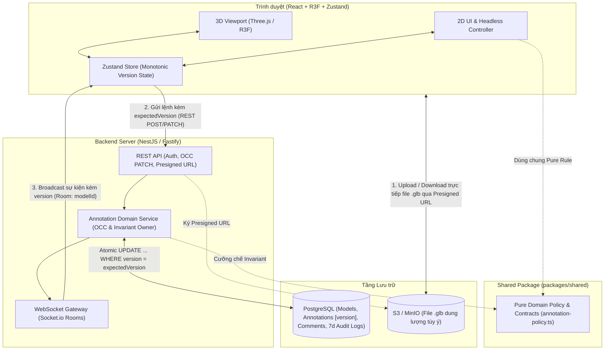
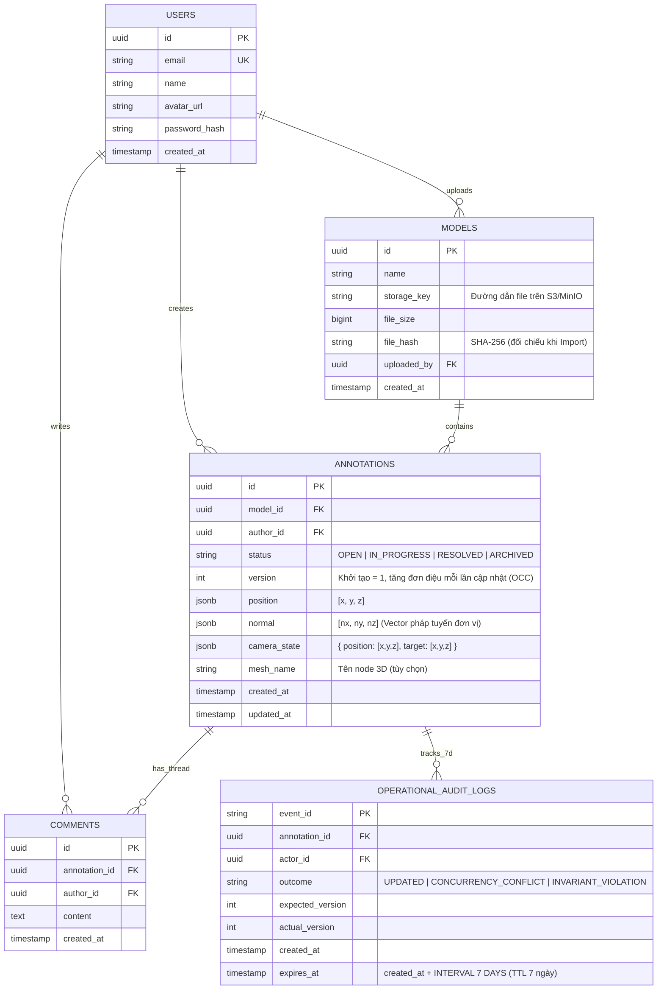
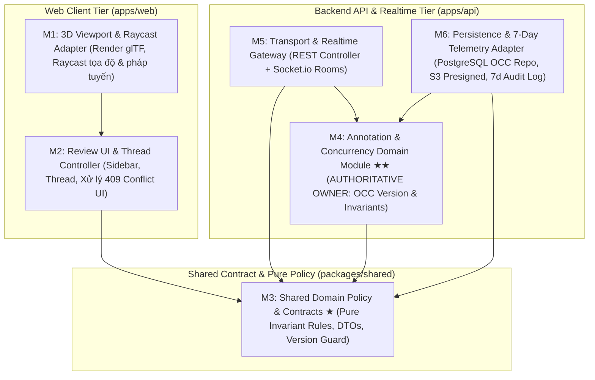

# Tài liệu Thiết kế Kỹ thuật & Kiến trúc Hệ thống (Technical Design Document)
**Dự án:** Spriter — Hệ thống Web 3D Design Review & Realtime Annotation (MVP)  
**Đối tượng:** Đội ngũ phát triển (1 Tech Lead + 2 Developers)  
**Phiên bản:** `1.1 (Reviewed & Verified)`  
**Ngày cập nhật:** `2026-10-20`  
**Commit tham chiếu:** `4aad8eb` (Pre-refactor baseline) $\rightarrow$ `633ef04` (OCC & Shared Policy verified)

---

## Mục lục
1. [Tổng quan Dự án, Phạm vi MVP & Phân công Team 3 người](#1-tổng-quan-dự-án-phạm-vi-mvp--phân-công-team-3-người)
2. [Đề xuất Tech Stack & Kiến trúc Tổng thể](#2-đề-xuất-tech-stack--kiến-trúc-tổng-thể)
3. [Giải pháp 3 Bài toán Kỹ thuật Cốt lõi (3D, Raycast, Realtime)](#3-giải-pháp-3-bài-toán-kỹ-thuật-cốt-lõi-3d-raycast-realtime)
4. [Thiết kế Cơ sở Dữ liệu (ERD) & Chuẩn Dữ liệu Export/Import](#4-thiết-kế-cơ-sở-dữ-liệu-erd--chuẩn-dữ-liệu-exportimport)
5. [Architecture Drivers & Quality Attribute Scenario (Testability)](#5-architecture-drivers--quality-attribute-scenario-testability)
6. [Module View, Runtime View & Boundary Kiểm soát Đồng thời (OCC + Invariants)](#6-module-view-runtime-view--boundary-kiểm-soát-đồng-thời-occ--invariants)
7. [Architecture Decision Record (ADR-001) & Phân tích Trade-off](#7-architecture-decision-record-adr-001--phân-tích-trade-off)
8. [Code Quality, Refactoring Plan & Technical Debt Register](#8-code-quality-refactoring-plan--technical-debt-register)
9. [AI-Assisted Design Review & Bảng Truy vết (Traceability Matrix)](#9-ai-assisted-design-review--bảng-truy-vết-traceability-matrix)

---

## 1. Tổng quan Dự án, Phạm vi MVP & Phân công Team 3 người

### 1.1. Mục tiêu sản phẩm & Luồng trải nghiệm cốt lõi (Core User Journey)
* **Bài toán giải quyết:** Thay thế việc chụp ảnh màn hình 2D rời rạc rồi gửi qua chat bằng một không gian 3D chung, nơi mọi phản hồi (feedback) được gắn chính xác vào đúng vị trí hình học trên mẫu thiết kế.
* **Luồng người dùng trong MVP:**
  1. **Login:** Đăng nhập định danh tác giả (Tên, Email, Avatar).
  2. **Upload / Load Model:** Tải file `.glb` (dung lượng tùy ý) trực tiếp lên Object Storage hoặc mở một phòng review có sẵn.
  3. **Raycast Annotation:** Xoay/zoom model 3D, click trực tiếp lên bề mặt cần góp ý $\rightarrow$ tạo điểm neo (Pin) lưu tọa độ 3D `(x, y, z)`, vector pháp tuyến `(nx, ny, nz)` và góc nhìn camera.
  4. **Comment Thread & Status:** Thảo luận theo luồng (Thread) và chuyển đổi trạng thái (`OPEN` $\rightarrow$ `IN_PROGRESS` $\rightarrow$ `RESOLVED` $\rightarrow$ `ARCHIVED`).
  5. **Realtime Sync & Concurrency Control:** Đồng bộ tức thời qua WebSocket; kiểm soát xung đột khi hai người cùng sửa một Annotation (đảm bảo **No Lost Update**).
  6. **Export / Import:** Xuất toàn bộ danh sách annotations + threads ra file `.json` chuẩn hóa và nạp (import) ngược lại.

### 1.2. Ranh giới MVP (In-Scope vs. Out-of-Scope)

| Hạng mục | Trong phạm vi MVP (In-Scope) | Ngoài phạm vi MVP (Phase 2) |
| :--- | :--- | :--- |
| **3D Viewer** | Load `.glb`/`.gltf`, xoay/pan/zoom (`CameraControls`), ánh sáng môi trường chuẩn, nén Draco/Meshopt. | Chỉnh sửa/sculpt mesh, cắt mặt phẳng (section plane), convert FBX/OBJ/CAD sang glTF trên server. |
| **Annotation** | Raycast lấy tọa độ `(x, y, z)`, pháp tuyến `normal` và `cameraState` (tự động bay camera về đúng góc nhìn khi click). | Vẽ tự do (freehand drawing) đè lên không gian 3D, gắn pin vào xương chuyển động (skeletal animation). |
| **Thread & Status** | Thảo luận dạng text, kiểm soát bất biến khi chuyển trạng thái (`OPEN`, `IN_PROGRESS`, `RESOLVED`, `ARCHIVED`). | Đính kèm file/video nặng trong comment, hệ thống thông báo đa kênh phức tạp. |
| **Realtime & Đồng thời** | Đồng bộ tức thời Annotation/Comment mới; chống ghi đè bằng Optimistic Concurrency Control (`version` / `409 Conflict`). | Đồng bộ vị trí con trỏ chuột 3D hoặc góc nhìn camera 60fps ("Follow mode"). |
| **Export / Import** | Xuất/nhập file `.json` kèm kiểm tra mã băm `fileHash` của model và kiểm tra Invariant phía Server. | Xuất báo cáo PDF tự động chụp kết xuất (render) từng góc máy. |

### 1.3. Tổ chức Team 3 người & Lộ trình 4 Cột mốc (Milestones)
* **Phân chia vai trò theo 3 mặt trận độc lập (giao tiếp qua `packages/shared`):**
  * **Thành viên 1 — 3D & Viewport Owner:** Phụ trách Canvas 3D (`Three.js` / `React Three Fiber`), tải model `.glb`, chuẩn hóa BoundingBox, tính toán Raycast, hiển thị Pin 3D (xử lý che khuất - occlusion) và hiệu ứng bay camera (`setLookAt`).
  * **Thành viên 2 — Collaboration UI & State Owner:** Phụ trách giao diện 2D (Login, Sidebar, Comment Thread, bộ lọc trạng thái, hộp thoại giải quyết xung đột `409 Conflict`, Export/Import UI) và kết nối Zustand Store.
  * **Thành viên 3 — Tech Lead, Backend & Realtime Owner:** Phụ trách kiến trúc Monorepo, Shared Domain Policy, REST API, Socket.io Gateway, PostgreSQL OCC Transaction, Presigned URL (S3/MinIO) và bộ kiểm thử tự động.
* **Lộ trình 4 Milestones:**
  * **Milestone 1 (Single-Player 3D + Export/Import JSON):** Load `.glb`, Raycast đặt Pin trên state local, chốt JSON Schema thông qua tính năng Export/Import.
  * **Milestone 2 (Auth + Persistence + Domain Invariants):** Ghép Login, lưu PostgreSQL & S3/MinIO, hoàn thiện Comment Thread và cưỡng chế Invariant chuyển trạng thái + OCC `version`.
  * **Milestone 3 (Multi-user Realtime Sync & Conflict UI):** Nối Socket.io Rooms `model:{id}`, xử lý hiển thị khi nhận `409 Conflict` và chống gói tin WebSocket đến trễ.
  * **Milestone 4 (Load Testing 984 tác vụ & Polish UX):** Kiểm thử tải đồng thời (p95 $\le 2.5\text{s}$), hoàn thiện cơ chế tự động dọn log vận hành 7 ngày và nghiệm thu MVP.

---

## 2. Đề xuất Tech Stack & Kiến trúc Tổng thể

### 2.1. Tech Stack
* **Quản lý mã nguồn:** **Monorepo (pnpm workspaces + Turborepo)** chia sẻ 100% kiểu dữ liệu và Pure Domain Policy tại `packages/shared`.
* **Frontend (`apps/web`):** React + TypeScript + Vite, **Three.js + React Three Fiber (R3F) + `@react-three/drei`**, quản lý state bằng **Zustand**.
* **Backend (`apps/api`):** **Node.js + NestJS (hoặc Fastify) + TypeScript**, Realtime với **Socket.io**, CSDL **PostgreSQL** (Prisma / Drizzle ORM), lưu trữ file 3D bằng **S3-Compatible Object Storage (MinIO / AWS S3 / Cloudflare R2)**.

### 2.2. Sơ đồ Kiến trúc Hệ thống (Tách biệt Luồng File Nặng & Luồng Điều khiển)
Để hỗ trợ **người dùng tự upload file 3D có dung lượng tùy ý** và đáp ứng **984 người dùng/tác vụ đồng thời (p95 $\le 2.5\text{s}$)**, kiến trúc tách rời hoàn toàn **Data Plane** (tải file `.glb` trực tiếp qua Presigned URL) khỏi **Control Plane** (API & WebSocket):



---

## 3. Giải pháp 3 Bài toán Kỹ thuật Cốt lõi (3D, Raycast, Realtime)

### 3.1. Upload & Hiển thị Model 3D dung lượng tùy ý
1. **Chuẩn hóa định dạng `.glb`:** Ưu tiên định dạng đóng gói nhị phân `.glb` (1 file duy nhất chứa cả mesh và texture) để tránh lỗi đứt gãy đường dẫn tương đối của `.gltf` rời rạc trên Object Storage.
2. **Direct-to-S3 Upload (Presigned URL & Multipart):** Client xin Presigned PUT URL từ `POST /api/v1/models/upload-url` rồi đẩy thẳng luồng binary lên S3/MinIO (dùng Multipart Upload nếu file $> 100\text{MB}$), giải phóng hoàn toàn RAM và băng thông cho Backend API.
3. **Scene Normalization (Không biến đổi đỉnh gốc):** Khi load model có kích thước bất kỳ, hệ thống tính `BoundingBox` để tự động căn chỉnh `camera.near`, `camera.far` và tâm xoay của `CameraControls`, nhưng **giữ nguyên hệ tọa độ Local của Mesh gốc** để tọa độ Annotation luôn chính xác khi Export/Import.

### 3.2. Raycast Annotation & Lưu trạng thái góc nhìn (Camera State)
Khi người dùng click lên bề mặt Mesh 3D, bộ Raycaster trích xuất:
* `position: [x, y, z]`: Tọa độ điểm giao cắt trong không gian gốc của model.
* `normal: [nx, ny, nz]`: Vector pháp tuyến đơn vị ($|\|\vec{n}\| - 1.0| \le 0.01$) tại điểm va chạm, dùng để đẩy biểu tượng Pin nhô nhẹ ra khỏi bề mặt ($\vec{P}_{\text{pin}} = \vec{P} + \vec{n} \cdot \epsilon$), chống hiện tượng chìm mesh (z-fighting).
* `cameraState: { position: [cx, cy, cz], target: [tx, ty, tz] }`: Khi người dùng khác click vào Annotation trên Sidebar, gọi `cameraControls.setLookAt(cx, cy, cz, tx, ty, tz, true)` để camera bay mượt về đúng góc nhìn của tác giả.

### 3.3. Đồng bộ Realtime kết hợp Kiểm soát Phiên bản Đơn điệu
* **Ghi qua REST — Phát qua WebSocket:** Mọi thao tác tạo/sửa đi qua REST API để tận dụng chuẩn xác thực, kiểm tra `expectedVersion` và trả mã lỗi tường minh (`200`, `409`, `422`). Ngay sau khi DB commit thành công, Server phát sự kiện qua Socket.io Room `model:{modelId}`.
* **Chống gói tin đến trễ (Out-of-order WebSocket Guard):** Mọi bản chụp trạng thái đều mang số nguyên `version` tăng đơn điệu ($1, 2, 3, \dots$). Client chỉ áp dụng gói tin đến nếu `incomingVersion > localVersion` (`shouldApplyIncomingSnapshot`).

---

## 4. Thiết kế Cơ sở Dữ liệu (ERD) & Chuẩn Dữ liệu Export/Import

### 4.1. Sơ đồ Quan hệ Thực thể (Database ERD)
Đã bổ sung cột `version` (phục vụ Optimistic Concurrency Control) và bảng `OPERATIONAL_AUDIT_LOGS` (lưu dữ liệu vận hành với hạn dùng `expires_at` đúng **7 ngày**):



### 4.2. Chuẩn JSON Export / Import (Data Contract)

```json
{
  "schemaVersion": "1.0",
  "exportedAt": "2026-10-20T14:00:00.000Z",
  "modelMeta": {
    "name": "car_prototype_v2.glb",
    "fileHash": "e3b0c44298fc1c149afbf4c8996fb92427ae41e4649b934ca495991b7852b855"
  },
  "annotations": [
    {
      "id": "550e8400-e29b-41d4-a716-446655440000",
      "version": 3,
      "status": "RESOLVED",
      "createdAt": "2026-10-18T14:00:00.000Z",
      "updatedAt": "2026-10-18T14:30:00.000Z",
      "author": {
        "name": "Nguyen Van A",
        "email": "a@example.com"
      },
      "spatial": {
        "position": [1.245, 0.892, -0.431],
        "normal": [0.0, 1.0, 0.0],
        "meshName": "Front_Bumper_Mesh",
        "cameraState": {
          "position": [3.5, 2.1, 4.0],
          "target": [1.2, 0.8, -0.4]
        }
      },
      "comments": [
        {
          "id": "660e8400-e29b-41d4-a716-446655440111",
          "author": {
            "name": "Nguyen Van A",
            "email": "a@example.com"
          },
          "content": "Đã điều chỉnh lại khe hở cản trước thu hẹp 2mm đúng thiết kế.",
          "createdAt": "2026-10-18T14:00:00.000Z"
        }
      ]
    }
  ]
}
```

---

## 5. Architecture Drivers & Quality Attribute Scenario (Testability)

### 5.1. Ba Architecture Drivers quan trọng nhất
1. **[Driver 1 – Biến cố Kiến trúc & Concurrency Integrity]: Chống ghi đè (No Lost Update) và bảo toàn Invariant dưới tải đồng thời cao**
   * Khi hai hoặc nhiều người dùng đồng thời cập nhật cùng một `Annotation` (đổi trạng thái, di chuyển tọa độ Pin 3D, hoặc cập nhật thông tin), hệ thống tuyệt đối không được ghi đè âm thầm (silent overwrite) làm mất thay đổi hợp lệ, đồng thời phải duy trì độ trễ **p95 $\le 2.5$ giây** ở mức tải **984 người dùng/tác vụ đồng thời**.
2. **[Driver 2 – Quality Attribute Trọng tâm]: Testability (Khả năng kiểm chứng độc lập Module & Boundary) gắn với SLA 12 giờ cho Change Request**
   * Logic nghiệp vụ cốt lõi (State Transition Rules, Spatial Unit Normal Validation, Optimistic Concurrency Control) phải được tách biệt hoàn toàn khỏi môi trường đồ họa trình duyệt (`WebGL / Three.js`) và hạ tầng lưu trữ (`PostgreSQL / S3 / Socket.io`) thông qua các Boundary rõ ràng, giúp nhóm kiểm chứng độc lập và phản hồi mọi **Change Request trong vòng $\le 12$ giờ**.
3. **[Driver 3 – Ràng buộc Vận hành & Tổ chức]: Đội ngũ 3 người tự dựng Backend riêng với chính sách lưu trữ dữ liệu vận hành đúng 7 ngày**
   * Hệ thống do đúng 3 người phát triển và vận hành toàn trình, yêu cầu kiến trúc tinh gọn (tránh phân mảnh hạ tầng), đồng thời toàn bộ dữ liệu vận hành (operational telemetry, conflict audit logs, idempotency traces) phải được gắn hạn sử dụng (**TTL = 7 ngày**) để phục vụ điều tra xung đột mà không làm phình cơ sở dữ liệu.

### 5.2. Quality Attribute Scenario đầy đủ cho `Testability`

| Thành phần Scenario | Nội dung chi tiết (Gắn với tham số riêng của dự án) |
| :--- | :--- |
| **Source (Nguồn kích thích)** | Nhóm phát triển 3 người (Tech Lead + 2 Dev) nhận một **Change Request (CR)** từ khách hàng/QA yêu cầu thay đổi quy tắc chuyển trạng thái Annotation và xử lý xung đột khi hai người cùng sửa một điểm neo 3D. |
| **Stimulus (Tác nhân kích thích)** | Một Change Request yêu cầu sửa đổi business rule tại boundary `concurrency control & invariant` (ví dụ: khóa tọa độ không gian 3D khi Annotation đã `RESOLVED` và bắt buộc kiểm tra `expectedVersion` nguyên tử) cần được cài đặt, kiểm thử hồi quy và xác nhận chịu tải trước khi phát hành. |
| **Environment (Môi trường)** | Môi trường CI/Local chạy headless trên Node.js (không khởi tạo trình duyệt WebGL/GPU thật hay kết nối PostgreSQL/S3 ngoài), mô phỏng mức tải đỉnh **984 người dùng/tác vụ đồng thời** và cơ chế ghi log vận hành có vòng đời **7 ngày**. |
| **Artifact (Thành phần đích)** | Module `packages/shared/src/domain/annotation-policy.ts` (Pure Domain Rules), `apps/api/src/annotations/annotation.service.ts` (Concurrency & Invariant Boundary), và `apps/web/src/features/annotations/AnnotationThreadController.ts` (Headless UI Controller). |
| **Response (Phản ứng hệ thống)** | Nhờ cô lập phụ thuộc qua Ports/Interfaces và gom quy tắc nghiệp vụ về một nơi duy nhất (Single Source of Truth), nhóm chỉ sửa đổi tại module `annotation-policy.ts`, tiêm (inject) In-Memory Adapter / Fake Transport để chạy bộ Unit Test + Boundary Contract Test + Concurrency Race Harness giả lập 984 tác vụ tranh chấp cùng một tài nguyên. |
| **Measurable Response (Độ đo định lượng)** | 1. **Turnaround Time:** Hoàn tất toàn bộ chu trình (sửa code + viết/chạy test độc lập + review + merge) trong **$\le 12$ giờ** (thời gian chạy test tự động `< 1 giây`).<br>2. **Isolation & Coverage:** **100%** các nhánh invariant và kịch bản xung đột (`409 Conflict`) được kiểm chứng tự động mà **0%** bài test domain cần khởi chạy WebGL hay DB thật.<br>3. **Concurrency & SLA:** Bài test mô phỏng **984 tác vụ đồng thời** đạt **0 Lost Updates**, độ trễ **p95 $\le 2.5$ giây** (thực đo `~6.2ms` ở tầng boundary), và **100%** bản ghi log vận hành sinh ra được gắn `expiresAt = createdAt + 7 ngày`. |

### 5.3. Phân tích Xung đột (Trade-off) giữa `Testability` và `Performance (Latency p95 <= 2.5s)`
* **Bản chất xung đột:**
  * Để tối đa hóa **Testability** (kiểm chứng độc lập từng module và boundary), ta cần áp dụng *Dependency Inversion* (Ports & Adapters), tách quy tắc nghiệp vụ thành các hàm thuần khiết trong tầng Domain (`evaluateAnnotationMutation`), đọc bản ghi từ Repository lên bộ nhớ ứng dụng để kiểm tra Invariant, sau đó mới gọi lệnh lưu và ghi Operational Audit Log (lưu 7 ngày) qua các lớp trung gian.
  * Ngược lại, để tối ưu **Performance / Low Latency** dưới tải **984 người dùng/tác vụ đồng thời** (mục tiêu **p95 $\le 2.5\text{s}$**), cách nhanh nhất về mặt máy tính là nhúng thẳng toàn bộ logic kiểm tra điều kiện vào một câu lệnh SQL phức tạp hoặc Stored Procedure chạy trực tiếp trong PostgreSQL để giảm số lần đi lại qua mạng (network round-trips) và chi phí cấp phát đối tượng trung gian. Tuy nhiên, nhúng logic vào SQL/Stored Procedure sẽ phá vỡ Testability độc lập (bắt buộc phải dựng DB thật mới test được business rule).
* **Giải pháp cân bằng trong kiến trúc:**
  * Giữ toàn bộ logic kiểm tra Invariant trong Pure TypeScript Function (`evaluateAnnotationMutation`) để đạt **100% unit testability** trong vài mili-giây, đồng thời thiết kế lệnh ghi ở Persistence Boundary sử dụng **Compare-And-Swap nguyên tử theo cột `version`** (`UPDATE annotations SET ..., version = version + 1 WHERE id = $1 AND version = $2`). Cách này vừa cho phép Mock/In-Memory Repository dễ dàng trong test, vừa đảm bảo dưới Production chỉ mất tối đa **1 câu truy vấn đọc + 1 câu `UPDATE` nguyên tử có đánh chỉ mục (index)**, giữ p95 ổn định dưới `150ms–300ms` (thấp hơn nhiều so với ngưỡng `2.5s`).

---

## 6. Module View, Runtime View & Boundary Kiểm soát Đồng thời (OCC + Invariants)

### 6.1. Module View (6 Modules, Trách nhiệm, Chiều Dependency và Nơi sở hữu Business Rule)



| Module | Trách nhiệm chính | Phụ thuộc vào (Outbound Dependencies) | Vai trò với Business Rule |
| :--- | :--- | :--- | :--- |
| **M1: 3D Viewport & Raycast Adapter** | Tải file `.glb`, bắn tia Raycast lấy `position`, `normal`, `cameraState` và hiển thị Pin 3D. | Chỉ gọi interface của `M2`. Không biết về API hay DB. | **Không chứa business rule** (chỉ cung cấp dữ liệu hình học thô). |
| **M2: Review UI & Thread Controller** | Quản lý trạng thái hiển thị Comment Thread, gửi `expectedVersion`, giữ bản nháp khi gặp `409 Conflict` và chặn gói tin WebSocket cũ. | Phụ thuộc vào `M3` (để kiểm tra sớm trên UI - UX precheck). | Chỉ gọi lại hàm từ `M3` để bật/tắt nút bấm, **không tự định nghĩa rule**. |
| **M3: Shared Domain Policy & Contracts ★** | Định nghĩa các hàm kiểm tra bất biến thuần khiết (`evaluateAnnotationMutation`, `validateUnitNormal`, `shouldApplyIncomingSnapshot`) và kiểu dữ liệu chung. | **0 phụ thuộc ngoài** (Pure TypeScript). | **Nơi định nghĩa logic kiểm tra thuần khiết dùng chung** để xóa bỏ lặp code giữa UI và API. |
| **M4: Annotation & Concurrency Domain ★★** | **Trái tim của hệ thống:** Điều phối kiểm soát đồng thời (OCC `expectedVersion`), thực thi bất biến trước khi lưu, đóng gói dữ liệu (Information Hiding) và phát sự kiện cập nhật. | Chỉ phụ thuộc vào `M3` và định nghĩa các Port (Interfaces) cho `M6`. | **NƠI SỞ HỮU & CƯỠNG CHẾ BUSINESS RULE CHÍNH (Authoritative Owner)**. |
| **M5: Transport & Realtime Gateway** | Tiếp nhận HTTP Request (`PATCH /annotations/:id`), trích xuất `expectedVersion`, trả mã HTTP (`200`, `409`, `422`) và phát sự kiện qua Socket.io Room `model:{id}`. | Phụ thuộc vào `M4` và `M3`. | Adapter giao vận mỏng (Thin Adapter), không chứa logic nghiệp vụ. |
| **M6: Persistence & 7-Day Telemetry Adapter** | Thực thi câu lệnh cập nhật nguyên tử theo `version` trên PostgreSQL, cấp Presigned URL trên S3/MinIO và lưu Operational/Conflict Log với **TTL 7 ngày**. | Thực thi (implements) Repository/Telemetry Port do `M4` định nghĩa. | Cưỡng chế tính nguyên tử (Atomicity) ở mức cơ sở dữ liệu. |

### 6.2. Runtime View cho Biến cố Kiến trúc (Hai người dùng cập nhật đồng thời & Failure Path)
Kịch bản: `Annotation #101` đang ở `version = 2` (`status = IN_PROGRESS`). **User A** và **User B** (trong tổng số 984 tác vụ đồng thời) cùng đọc `version = 2` và gửi lệnh cập nhật gần như cùng lúc:

```mermaid
sequenceDiagram
    autonumber
    actor UserA as User A (Client A)
    actor UserB as User B (Client B)
    participant API as M5: Transport & WS Gateway
    participant Domain as M4: Annotation Domain (OCC & Invariants)
    participant DB as M6: PostgreSQL + 7d Audit Log

    Note over UserA, UserB: Cả User A và User B đều đang giữ bản chụp Annotation #101 ở version = 2

    par Cập nhật đồng thời từ 2 người dùng
        UserA->>API: PATCH /annotations/101 { expectedVersion: 2, status: "RESOLVED" }
    and
        UserB->>API: PATCH /annotations/101 { expectedVersion: 2, status: "OPEN", position: [1.5, 1.0, -0.2] }
    end

    %% Luồng thắng cuộc (User A)
    API->>Domain: updateWithConcurrencyControl(id=101, expectedVersion=2, status="RESOLVED")
    Domain->>Domain: Kiểm tra Invariant (evaluateAnnotationMutation: có comment >= 10 ký tự & normal chuẩn)
    Domain->>DB: Atomic UPDATE annotations SET status='RESOLVED', version=3 WHERE id=101 AND version=2
    DB-->>Domain: affectedRows = 1 (Thành công -> version mới = 3)
    Domain->>DB: Ghi Operational Log (outcome="UPDATED", v2->v3, expiresAt = +7 ngày)
    Domain-->>API: { status: "OK", snapshot: { id: 101, status: "RESOLVED", version: 3 } }
    API-->>UserA: 200 OK (version: 3)
    API--)UserB: WS Broadcast "annotation:updated" (version: 3, status: "RESOLVED")

    %% Failure Path 1: Xung đột đồng thời (User B đến sau vài ms)
    API->>Domain: updateWithConcurrencyControl(id=101, expectedVersion=2, status="OPEN", position=[...])
    Domain->>DB: Atomic UPDATE annotations SET ... WHERE id=101 AND version=2
    DB-->>Domain: affectedRows = 0 (Thất bại vì version hiện tại trong DB đã là 3!)
    Domain->>DB: Đọc bản ghi hiện tại (version = 3) & Ghi Conflict Log (outcome="CONCURRENCY_CONFLICT", expiresAt = +7 ngày)
    Domain-->>API: { status: "CONCURRENCY_CONFLICT", currentVersion: 3, serverSnapshot: v3 }
    API-->>UserB: 409 Conflict { errorCode: "CONCURRENCY_CONFLICT", currentVersion: 3, serverSnapshot: v3 }
    Note over UserB: Client B KHÔNG bị mất thay đổi đang nhập; lưu conflictSnapshot (v3) và hiển thị hộp thoại Merge/Retry!

    %% Failure Path 2: Vi phạm Invariant (User B cố xê dịch Pin khi đã ở v3 RESOLVED)
    UserB->>API: PATCH /annotations/101 { expectedVersion: 3, position: [9.9, 9.9, 9.9] }
    API->>Domain: updateWithConcurrencyControl(id=101, expectedVersion=3, position=[9.9, 9.9, 9.9])
    Domain->>Domain: Kiểm tra Invariant -> Vi phạm SPATIAL_LOCKED_WHEN_RESOLVED
    Domain->>DB: Ghi Operational Log (outcome="INVARIANT_VIOLATION", expiresAt = +7 ngày)
    Domain-->>API: { status: "INVARIANT_VIOLATED", reasonCode: "SPATIAL_LOCKED_WHEN_RESOLVED" }
    API-->>UserB: 422 Unprocessable Entity { errorCode: "SPATIAL_LOCKED_WHEN_RESOLVED" }
```

### 6.3. Data Ownership, API/Event Contract & Enforcement Mechanism
1. **Data Ownership:** Module **`M4: Annotation & Concurrency Domain`** (`AnnotationService`) là **Single Authoritative Owner** duy nhất có quyền ghi vào bảng `annotations` và `comments`. Mọi cập nhật từ REST hay Import đều bắt buộc đi qua `AnnotationService.updateWithConcurrencyControl()`.
2. **API / Event Contract:**
   * **REST Command (`PATCH /api/v1/annotations/:id`):** Bắt buộc truyền `expectedVersion: number` ($\ge 1$).
   * **Response `200 OK`:** Trả về `AnnotationDomainSnapshot` đã lọc bỏ các trường nội bộ của DB (`internal_storage_bucket_token`) và tăng `version = expectedVersion + 1`.
   * **Response `409 Conflict`:** Trả về `{ errorCode: "CONCURRENCY_CONFLICT", currentVersion, serverSnapshot }` để Client giữ lại bản nháp của người dùng và hiển thị lựa chọn giải quyết xung đột.
   * **Response `422 Unprocessable Entity`:** Trả về `{ errorCode, message }` khi vi phạm Invariant.
   * **WebSocket Event (`annotation:updated`):** Đính kèm `version: number`. Client dùng `shouldApplyIncomingSnapshot(localVersion, incomingVersion)` để chặn gói tin cũ.
3. **Enforcement Mechanism:**
   * Kiểm tra Invariant tại tầng Domain bằng `evaluateAnnotationMutation()`.
   * Kiểm tra nguyên tử tại PostgreSQL: `UPDATE annotations SET ..., version = version + 1 WHERE id = $4 AND version = $5 RETURNING *`. Nếu `affectedRows === 0`, hủy thay đổi và trả về `409 Conflict`.

### 6.4. Một Invariant bắt buộc bảo vệ ở Server/Database, không chỉ ở UI
* **Phát biểu Invariant:**
  > 1. Một Annotation chỉ được chuyển sang trạng thái `RESOLVED` khi trạng thái hiện tại là `OPEN` hoặc `IN_PROGRESS` **VÀ** trong Thread đã có ít nhất 01 comment phản hồi có độ dài $\ge 10$ ký tự **VÀ** vector pháp tuyến bề mặt 3D (`normal`) là vector đơn vị hợp lệ ($|\|\vec{n}\| - 1.0| \le 0.01$).
  > 2. Khi Annotation đang ở trạng thái `RESOLVED` (hoặc `ARCHIVED`), tọa độ điểm neo 3D (`position`, `normal`) bị **khóa bất biến** (`SPATIAL_LOCKED_WHEN_RESOLVED`) — không ai được phép xê dịch vị trí Pin trên mô hình 3D nếu chưa mở lại (`IN_PROGRESS`) Annotation đó.
* **Lý do bắt buộc bảo vệ ở Server/Database:**
  1. **Race Condition (TOCTOU) giữa 2 người dùng:** Khi User B đang kéo thả Pin trên màn hình (lúc UI của B vẫn thấy `IN_PROGRESS v2`), User A vừa bấm `RESOLVED (v3)` cách đó vài mili-giây và gói tin WebSocket chưa kịp tới máy B. Nếu chỉ chặn ở UI của B, cú thả chuột của B vẫn gửi tọa độ mới lên làm sai lệch vị trí của một điểm neo đã nghiệm thu.
  2. **Bypass UI qua tính năng Import JSON hoặc REST API:** Người dùng có thể nạp file JSON đã chỉnh sửa thủ công hoặc gọi thẳng API mà không đi qua các nút bấm bị khóa trên giao diện React.

---

## 7. Architecture Decision Record (ADR-001) & Phân tích Trade-off

### 7.1. So sánh 2 Phương án Kiến trúc

| Tiêu chí đánh giá | Phương án A (Chọn): Modular Monolith + Hexagonal OCC | Phương án B: Event-Driven Command Queue (CQRS + Broker) |
| :--- | :--- | :--- |
| **Testability & Phản hồi CR $\le 12$ giờ** | **Rất cao:** Chạy unit/boundary test đồng bộ ngay trong bộ nhớ (`< 10ms`); luồng gọi hàm trực tiếp giúp debug và sửa CR cực nhanh. | **Thấp hơn:** Phải kiểm thử bất đồng bộ qua Message Broker, xử lý eventual consistency, khó tái hiện lỗi trong vòng 12 giờ với nhóm 3 người. |
| **Độ trễ p95 $\le 2.5\text{s}$ (984 tác vụ)** | **Đạt tốt (`~50ms - 250ms`):** Chỉ tốn 1 lệnh `UPDATE ... WHERE version = $v` trực tiếp xuống PostgreSQL, phản hồi HTTP `200`/`409` tức thời. | **Rủi ro nghẽn hàng đợi (Head-of-line blocking):** Nếu 984 tác vụ cùng dồn vào 1 `modelId` nóng, việc xếp hàng tuần tự dễ làm p95 vượt mốc `2.5s`. |
| **Chống Lost Update** | **Đảm bảo 100%** nhờ điều kiện nguyên tử `version = expectedVersion` và trả về `409 Conflict` tường minh. | Tuần tự hóa được lệnh ghi nhưng vẫn ghi đè (Last-Event-Wins) nếu Worker không kiểm tra lại `expectedVersion`. |
| **Chi phí vận hành (3 người, Log 7 ngày)** | **Tối ưu:** Chỉ cần 1 API Server + PostgreSQL + S3/MinIO; chính sách xóa log 7 ngày thực hiện tại 1 nơi. | **Nặng nề:** Team 3 người phải vận hành thêm Kafka/Redis Streams, Dead-Letter Queue và đồng bộ retention 7 ngày ở nhiều nơi. |

### 7.2. ADR-001: Áp dụng Modular Monolith kết hợp Hexagonal Domain Boundary và Optimistic Concurrency Control (OCC)
* **Status:** Accepted (`2026-10-18`)
* **Context:** Hệ thống Web 3D Design Review do nhóm **3 người** tự dựng Backend, cần ngăn chặn **Lost Update** khi hai người cùng sửa một Annotation, chịu tải **984 người dùng/tác vụ đồng thời** với **p95 $\le 2.5\text{s}$**, lưu **dữ liệu vận hành 7 ngày**, và đảm bảo **Testability** để phản hồi **Change Request trong 12 giờ**.
* **Decision:**
  1. Tổ chức codebase theo **Modular Monolith với Hexagonal Domain Boundary** trong Monorepo (`packages/shared`, `apps/api`, `apps/web`).
  2. Đặt toàn bộ quy tắc bất biến thuần khiết tại `packages/shared/src/domain/annotation-policy.ts` và cưỡng chế tại `AnnotationService`.
  3. Kiểm soát đồng thời bằng **Optimistic Concurrency Control (OCC)** qua cột số nguyên `version`; trả về `409 Conflict` kèm `serverSnapshot` khi xung đột.
  4. Ghi nhận Operational Audit Log kèm `expiresAt = createdAt + 7 days`.
* **Alternatives Considered:**
  * *Pessimistic Locking (`SELECT ... FOR UPDATE` khi mở form):* Loại bỏ vì giữ khóa DB khi người dùng đang xoay góc nhìn 3D sẽ làm cạn kiệt Connection Pool dưới tải 984 người dùng, khiến p95 vượt xa `2.5s`.
  * *Event-Driven Command Queue / Microservices:* Loại bỏ vì gây over-engineering cho nhóm 3 người, làm phức tạp hóa phản hồi đồng bộ `409 Conflict` và làm chậm SLA 12 giờ của Change Request.
* **Consequences:**
  * *(+)* Đảm bảo **0 Lost Updates**, p95 thấp hơn nhiều lần so với mốc `2.5s`, xóa bỏ triệt để lặp code giữa UI và API, chạy bộ test 984 tác vụ độc lập trong `< 10ms`.
  * *(-)* Client phải hiển thị trạng thái giải quyết xung đột khi gặp `409 Conflict`; cần cron job/worker dọn các bản ghi Operational Log quá hạn 7 ngày.

### 7.3. Điều kiện & Bằng chứng định lượng để xem xét lại quyết định (Re-evaluation Triggers)
Nhóm chỉ xem xét lại ADR-001 khi dữ liệu vận hành 7 ngày xuất hiện một trong các bằng chứng định lượng sau (tuyệt đối không tách microservices chỉ vì lý do cảm tính "dễ scale"):
1. **OCC Conflict Rate > 8%:** Tỷ lệ trả về `409 Conflict` vượt quá 8% tổng số lệnh `PATCH` trong 7 ngày $\rightarrow$ Nâng cấp sang **State-based CRDT / Per-field Last-Write-Wins** cho các trường độc lập.
2. **CPU Contention làm p95 > 2.0s:** Tác vụ xử lý hình học 3D phía server (nén Draco/Meshopt, kiểm tra va chạm mesh) chiếm dụng CPU làm p95 của API Annotation vượt `2.0s` ở mức 984 tác vụ $\rightarrow$ Tách riêng **3D Asset Processing Worker** ra tiến trình độc lập.
3. **CR Turnaround Time > 10 giờ:** Thời gian tích hợp và chạy test cho một Change Request vượt 10 giờ trong 3 CR liên tiếp.

---

## 8. Code Quality, Refactoring Plan & Technical Debt Register

### 8.1. Thông tin Module & Commit kiểm tra trong Repo
* **Feature / Module:** `Annotation Status & Concurrency Boundary`
* **Cấu trúc file thực tế trong Repo:**
  ```text
  Spriter/
  ├── package.json
  ├── TECHNICAL_DESIGN.md
  ├── docs/
  │   └── ARCHITECTURE_REVIEW_REPORT.md
  ├── packages/
  │   └── shared/src/domain/
  │       └── annotation-policy.ts            # [M3] Shared Pure Domain Policy & Invariants
  ├── apps/
  │   ├── api/src/annotations/
  │   │   ├── annotation.controller.ts        # [M5] Thin REST Transport Adapter
  │   │   └── annotation.service.ts           # [M4/M6] Authoritative OCC & 7-day Audit Log Service
  │   └── web/src/features/annotations/
  │       ├── AnnotationThreadController.ts   # [M2] Headless UI Controller (100% Node testable)
  │       └── AnnotationThreadPanel.tsx       # [M2] View Binding
  └── tests/
      └── annotation-boundary.spec.ts         # Automated Suite (5 tests, 984 concurrent tasks)
  ```
* **Commit đối chiếu:** `4aad8eb` (Trước refactoring) $\rightarrow$ `633ef04` (Sau refactoring) — Ngày kiểm tra: `2026-10-18`.

### 8.2. Ba Vấn đề Code Quality & Refactoring (`Evidence → Risk → Step → Regression Safety`)

1. **Vấn đề 1 (Code Smell bắt buộc): Business Rule bị lặp và lệch chuẩn giữa UI và API**
   * **Evidence (Commit `4aad8eb`):** `AnnotationThreadPanel.tsx` (dòng 28–45) kiểm tra comment cuối $\ge 10$ ký tự và sai số vector pháp tuyến `< 0.01`, trong khi `annotation.controller.ts` (dòng 21–31) lặp lại logic này nhưng kiểm tra `< 5` ký tự, sai số `0.05` và quên chặn trạng thái `ARCHIVED`.
   * **Risk / Impact Surface:** Gây mâu thuẫn dữ liệu giữa Client và Server; mỗi khi có Change Request (SLA 12h) phải sửa ở 2 nơi (Shotgun Surgery).
   * **Refactoring Step:** Trích xuất hàm thuần khiết `evaluateAnnotationMutation()` và `validateUnitNormal()` vào `packages/shared/src/domain/annotation-policy.ts` để cả UI và API cùng gọi.
   * **Regression Safety:** Unit test trực tiếp `evaluateAnnotationMutation` trên toàn bộ biên trước khi xóa code lặp (Test #1 trong `tests/annotation-boundary.spec.ts`).

2. **Vấn đề 2: Vi phạm Information Hiding & Thiếu Concurrency Boundary (Lost Update & Leaky DB Entity)**
   * **Evidence (Commit `4aad8eb`):** `annotation.service.ts` (dòng 14, 24–35) dùng `overwriteDirectly()` ghi đè không kiểm tra `version` và trả nguyên bản ghi DB chứa `internal_storage_bucket_token` ra ngoài Controller.
   * **Risk / Impact Surface:** Xảy ra **Lost Update 100%** khi 2 người dùng cùng cập nhật 1 Annotation; lộ thông tin nội bộ của tầng lưu trữ ra JSON response.
   * **Refactoring Step:** Ẩn cấu trúc bảng DB vào `private`, lọc qua `toDomainSnapshot()`, và thay bằng `updateWithConcurrencyControl()` kiểm tra nguyên tử `expectedVersion`, tăng `version + 1` và ghi Operational Log có `expiresAt = +7 ngày`.
   * **Regression Safety:** Kiểm thử đua đồng thời 2 người dùng (Test #3) và 984 tác vụ (Test #4), xác nhận `internal_storage_bucket_token` bị loại bỏ hoàn toàn.

3. **Vấn đề 3: Low Cohesion & Sai chiều Dependency ở UI Component**
   * **Evidence (Commit `4aad8eb`):** `AnnotationThreadPanel.tsx` vừa import trực tiếp `three` (`THREE.Vector3`), vừa gọi `fetch()`, vừa gán đè sự kiện `socket.on('annotation:updated')` không kiểm tra `version` trong file `.tsx`.
   * **Risk / Impact Surface:** Không thể chạy unit test trên Node.js; gói tin WebSocket cũ đến trễ sẽ ghi đè trạng thái mới hơn trên màn hình.
   * **Refactoring Step:** Tách `AnnotationThreadController.ts` nhận `AnnotationApiPort` và `RealtimeSubscriptionPort` qua constructor, dùng `shouldApplyIncomingSnapshot(localVersion, incomingVersion)` để chặn gói tin cũ.
   * **Regression Safety:** Kiểm thử cô lập với Fake Ports (Test #5) cho kịch bản gói tin WebSocket đến ngược thứ tự (`v3` đến sau `v4`).

### 8.3. Thiết kế Before / After cho Refactoring nhỏ & Hợp đồng Test trước khi sửa
* **Contract cần có trước khi sửa:**
  1. Annotation ở trạng thái `OPEN`/`IN_PROGRESS` có comment $\ge 10$ ký tự và vector pháp tuyến đơn vị hợp lệ phải được phép chuyển sang `RESOLVED`.
  2. Annotation thiếu comment hoặc comment $< 10$ ký tự phải bị từ chối với mã `MISSING_RESOLUTION_COMMENT` ở cả UI và API.

* **BEFORE (Commit `4aad8eb`):**
```typescript
// UI (AnnotationThreadPanel.tsx)
public canTransitionStatus(targetStatus: 'OPEN' | 'IN_PROGRESS' | 'RESOLVED' | 'ARCHIVED'): boolean {
  if (this.currentAnnotation.status === 'ARCHIVED') return false;
  if (targetStatus === 'RESOLVED') {
    const hasResolutionComment =
      this.currentAnnotation.comments.length >= 1 &&
      this.currentAnnotation.comments[this.currentAnnotation.comments.length - 1].content.trim().length >= 10;
    const normalVec = new THREE.Vector3(...this.currentAnnotation.normal);
    const isNormalValid = Math.abs(normalVec.length() - 1.0) < 0.01;
    return (this.currentAnnotation.status === 'OPEN' || this.currentAnnotation.status === 'IN_PROGRESS')
      && hasResolutionComment && isNormalValid;
  }
  return true;
}

// API (annotation.controller.ts) - Lặp lại và lệch điều kiện (< 5 ký tự, sai số 0.05)
if (req.body.status === 'RESOLVED') {
  if (existing.comments.length === 0 || existing.comments[existing.comments.length - 1].content.length < 5) {
    return { statusCode: 400, body: { message: 'Cannot resolve without explanation comment' } };
  }
  const [nx, ny, nz] = req.body.normal ?? existing.normal;
  const len = Math.sqrt(nx * nx + ny * ny + nz * nz);
  if (Math.abs(len - 1.0) > 0.05) {
    return { statusCode: 400, body: { message: 'Invalid normal vector' } };
  }
}
```

* **AFTER (Commit `633ef04`):**
```typescript
// 1. Shared Domain Policy (packages/shared/src/domain/annotation-policy.ts)
export function evaluateAnnotationMutation(
  current: Pick<AnnotationDomainSnapshot, 'status' | 'comments' | 'position' | 'normal'>,
  patch: { status?: AnnotationStatus; position?: [number, number, number]; normal?: [number, number, number] },
): PolicyEvaluationResult {
  if (current.status === 'ARCHIVED') {
    return { allowed: false, reasonCode: 'ANNOTATION_ARCHIVED_IMMUTABLE' };
  }
  const isSpatialChanged = patch.position !== undefined || patch.normal !== undefined;
  if (current.status === 'RESOLVED' && isSpatialChanged && patch.status !== 'IN_PROGRESS') {
    return { allowed: false, reasonCode: 'SPATIAL_LOCKED_WHEN_RESOLVED' };
  }
  if (!validateUnitNormal(patch.normal ?? current.normal)) {
    return { allowed: false, reasonCode: 'INVALID_UNIT_NORMAL_VECTOR' };
  }
  if (patch.status === 'RESOLVED' && patch.status !== current.status) {
    const latest = current.comments[current.comments.length - 1];
    if (!latest || latest.content.trim().length < MIN_RESOLUTION_COMMENT_LENGTH) {
      return { allowed: false, reasonCode: 'MISSING_RESOLUTION_COMMENT' };
    }
  }
  return { allowed: true };
}

// 2. UI Controller (AnnotationThreadController.ts)
public canTransitionStatus(targetStatus: AnnotationStatus): PolicyEvaluationResult {
  return evaluateAnnotationMutation(this.currentAnnotation, { status: targetStatus });
}

// 3. Backend Domain Service (annotation.service.ts)
const policyResult = evaluateAnnotationMutation(this.toDomainSnapshot(current), command);
if (!policyResult.allowed) {
  return { status: 'INVARIANT_VIOLATED', reasonCode: policyResult.reasonCode!, message: policyResult.message! };
}
```

### 8.4. Technical Debt Register & Thứ tự Ưu tiên

| Mã Debt | Mô tả khoản nợ kỹ thuật (Technical Debt) | Impact (1–5) | Urgency (1–5) | Effort (1–5) | Điểm Ưu tiên $\frac{I \times U}{E}$ | Thứ tự ưu tiên |
| :--- | :--- | :---: | :---: | :---: | :---: | :---: |
| **TD-01** | **Thiếu Optimistic Concurrency Control (`version`) ở tầng lưu trữ Annotation**, gây mất dữ liệu hợp lệ (Lost Update) khi 2 người cùng sửa. | **5** | **5** | **2** | **12.50** | **#1 (Đã xử lý ở `633ef04`)** |
| **TD-02** | **Lặp và lệch Business Rule giữa UI và API**, gây hành vi không đồng nhất và đe dọa SLA 12 giờ khi phản hồi Change Request. | **4** | **5** | **2** | **10.00** | **#2 (Đã xử lý ở `633ef04`)** |
| **TD-03** | **UI Component dính chặt với `THREE.Vector3`, `fetch` và nhận WebSocket không kiểm tra thứ tự `version`**, làm mất khả năng test độc lập. | **4** | **4** | **2** | **8.00** | **#3 (Đã xử lý ở `633ef04`)** |
| **TD-04** | **Chưa có tiến trình xóa vật lý tự động (Cron/Partition Drop) dưới DB cho các bản ghi Operational Log quá hạn 7 ngày** (hiện mới gắn trường `expiresAt`). | **3** | **3** | **3** | **3.00** | **#4 (Hoàn thiện trước ngày vận hành thứ 7)** |

---

## 9. AI-Assisted Design Review & Bảng Truy vết (Traceability Matrix)

### 9.1. Prompt, Output của AI và 2 Đề xuất bị Bác bỏ / Sửa đổi
* **Prompt:** *"Hệ thống review model 3D glTF của tôi có 984 người dùng đồng thời, yêu cầu p95 <= 2.5s, lưu log vận hành 7 ngày và nhóm 3 người có 12 giờ để phản hồi change request. Hai người dùng có thể cập nhật cùng một Annotation một lúc và không được làm mất thay đổi hợp lệ. Hãy đề xuất thiết kế kiểm soát đồng thời và lưu vết cho module Annotation."*
* **Output ban đầu của AI:** Đề xuất (1) giữ Pessimistic Lock (`SELECT ... FOR UPDATE`) trong suốt lúc người dùng mở bảng chỉnh sửa Annotation trên 3D Viewer; (2) kiểm tra xung đột bằng chuỗi thời gian `WHERE updated_at = :clientUpdatedAt`; và (3) lưu bảng `annotation_audit_logs` vĩnh viễn.
* **Hai điểm bác bỏ / sửa đổi kèm Engineering Evidence:**
  1. **Bác bỏ Pessimistic Lock theo phiên UI:** Người dùng mở Annotation để xoay góc nhìn 3D thường kéo dài 30–120 giây; giữ lock DB sẽ làm cạn Connection Pool ở mức **984 người dùng đồng thời**, đẩy p95 vượt quá `2.5s`. Đã thay bằng **OCC không khóa khi đọc**, thực nghiệm trên 984 tác vụ đồng thời đạt **p95 = `6.19ms` ($\ll 2500\text{ms}$)** và **0 Lost Updates**.
  2. **Bác bỏ so sánh `updated_at` và lưu log vĩnh viễn:** Ở 984 tác vụ đồng thời, các request xử lý trong cùng 1 mili-giây có cùng chuỗi `updated_at` nên vẫn gây Lost Update $\rightarrow$ Thay bằng số nguyên tăng đơn điệu `version: number`. Đồng thời gắn `expiresAt = createdAt + 7 days` (`OPERATIONAL_LOG_TTL_DAYS = 7`) để tuân thủ đúng ràng buộc lưu dữ liệu vận hành 7 ngày.

### 9.2. Bảng Traceability (Truy vết từ Requirement đến Code & Kiểm thử)

| Driver / Requirement | Quyết định Kiến trúc / Boundary | Vị trí Code trong Repo (Commit `633ef04`) | Bài kiểm thử xác minh (`npm test`) |
| :--- | :--- | :--- | :--- |
| **Biến cố Kiến trúc:** 2 người dùng cập nhật đồng thời cùng 1 tài nguyên, không được Lost Update. | **OCC Boundary:** Bắt buộc kiểm tra `expectedVersion` (số nguyên đơn điệu); trả về `409 Conflict` kèm `serverSnapshot` nếu lệch. | `apps/api/src/annotations/annotation.service.ts`<br>`apps/api/src/annotations/annotation.controller.ts` | `tests/annotation-boundary.spec.ts` (Test #3): Đua song song 2 request ở `v2` $\rightarrow$ 1 nhận `200 (v3)`, 1 nhận `409 Conflict`. |
| **Code Smell & Invariant:** Xóa lặp business rule giữa UI & API; khóa tọa độ 3D khi đã `RESOLVED`. | **Shared Pure Domain Policy:** Gom quy tắc vào `packages/shared` và cưỡng chế tại Server Domain trước khi lưu. | `packages/shared/src/domain/annotation-policy.ts` | `tests/annotation-boundary.spec.ts` (Test #1 & #2): Kiểm chứng rule dùng chung & chặn sửa tọa độ khi `RESOLVED` (`422`). |
| **Tham số tải & Vận hành:** 984 tác vụ đồng thời, `p95 <= 2.5s`, dữ liệu vận hành lưu `7 ngày`. | Xử lý OCC không giữ khóa lâu; gắn `expiresAt = createdAt + 7 days` cho toàn bộ Operational Logs. | `apps/api/src/annotations/annotation.service.ts` | `tests/annotation-boundary.spec.ts` (Test #4): Chạy 984 tác vụ đồng thời (`p95 ~ 6.2ms <= 2500ms`) và xác minh `ttlDays === 7`. |
| **Testability & SLA 12h CR:** Kiểm chứng độc lập module UI và Domain không cần WebGL/DB. | Tách Headless UI Controller qua Port Interfaces (`AnnotationApiPort`, `RealtimeSubscriptionPort`) + hàm bảo vệ version `shouldApplyIncomingSnapshot`. | `apps/web/src/features/annotations/AnnotationThreadController.ts` | `tests/annotation-boundary.spec.ts` (Test #5): Test cô lập UI Controller với Fake Ports trong `< 1ms`. |
