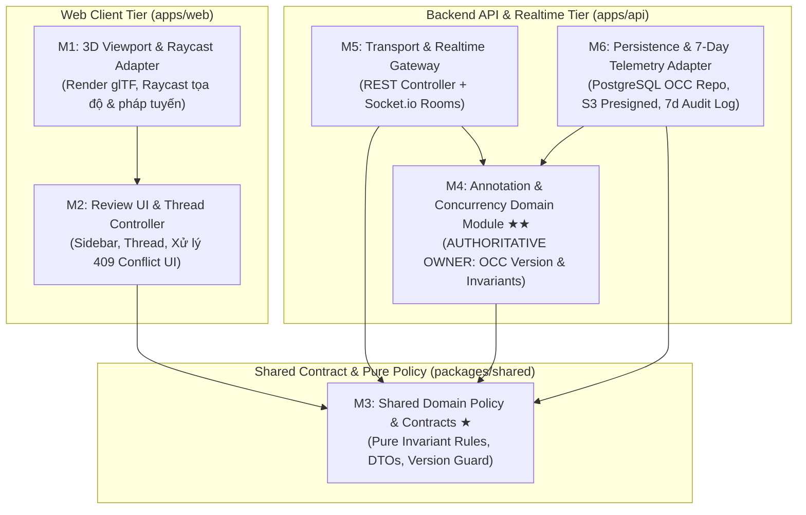

# Báo cáo Thiết kế Kiến trúc, Kiểm soát Đồng thời & Refactoring (Spriter 3D Design Review)

- **Dự án:** Spriter — Ứng dụng Web nhiều người cùng đặt Annotation lên model 3D (glTF) phục vụ review thiết kế
- **Quy mô nhóm:** 3 thành viên (1 Tech Lead + 2 Developers), tự xây dựng Backend riêng
- **Ngày kiểm tra:** `2026-10-18`
- **Commit đối chiếu:** `4aad8eb` (Trước refactoring) $\rightarrow$ `633ef04` (Sau refactoring & kiểm thử)

---

## PHẦN 1. Architecture Drivers và Quality Scenario (20 điểm)

### 1.1. Ba Architecture Drivers quan trọng nhất
1. **[Driver 1 - Biến cố Kiến trúc & Concurrency Integrity]: Chống ghi đè (No Lost Update) và bảo toàn Invariant dưới tải đồng thời cao**
   - Khi hai hoặc nhiều người dùng đồng thời cập nhật cùng một `Annotation` (đổi trạng thái, di chuyển tọa độ Pin 3D, hoặc cập nhật thông tin), hệ thống tuyệt đối không được ghi đè âm thầm (silent overwrite) làm mất thay đổi hợp lệ, đồng thời phải duy trì độ trễ **p95 $\le 2.5$ giây** ở mức tải **984 người dùng/tác vụ đồng thời**.
2. **[Driver 2 - Quality Attribute Trọng tâm]: Testability (Khả năng kiểm chứng độc lập Module & Boundary) gắn với SLA 12 giờ cho Change Request**
   - Logic nghiệp vụ cốt lõi (State Transition Rules, Spatial Normal Validation, Optimistic Concurrency Control) phải được tách biệt hoàn toàn khỏi môi trường đồ họa trình duyệt (`WebGL / Three.js`) và hạ tầng lưu trữ (`PostgreSQL / S3 / Socket.io`) thông qua các Boundary rõ ràng, giúp nhóm kiểm chứng độc lập và phản hồi mọi **Change Request trong vòng $\le 12$ giờ**.
3. **[Driver 3 - Ràng buộc Vận hành & Tổ chức]: Đội ngũ 3 người tự dựng Backend riêng với chính sách lưu trữ dữ liệu vận hành đúng 7 ngày**
   - Hệ thống do đúng 3 người phát triển và vận hành toàn trình, yêu cầu kiến trúc tinh gọn (tránh phân mảnh hạ tầng), đồng thời toàn bộ dữ liệu vận hành (operational telemetry, conflict audit logs, idempotency traces) phải được gắn hạn sử dụng (**TTL = 7 ngày**) để phục vụ điều tra xung đột mà không làm phình cơ sở dữ liệu.

---

### 1.2. Quality Attribute Scenario đầy đủ cho `Testability`

| Thành phần Scenario | Nội dung chi tiết (Gắn với tham số dự án) |
| :--- | :--- |
| **Source (Nguồn kích thích)** | Nhóm phát triển 3 người (Tech Lead + 2 Dev) nhận một **Change Request (CR)** từ khách hàng/QA yêu cầu thay đổi quy tắc chuyển trạng thái Annotation và xử lý xung đột khi hai người cùng sửa một điểm neo 3D. |
| **Stimulus (Tác nhân kích thích)** | Một Change Request yêu cầu sửa đổi business rule tại boundary `concurrency control & invariant` (ví dụ: khóa tọa độ không gian 3D khi Annotation đã `RESOLVED` và bắt buộc kiểm tra `expectedVersion` nguyên tử) cần được cài đặt, kiểm thử hồi quy và xác nhận chịu tải trước khi phát hành. |
| **Environment (Môi trường)** | Môi trường CI/Local chạy headless (không khởi tạo trình duyệt WebGL/GPU thật hay kết nối PostgreSQL/S3 ngoài), mô phỏng mức tải đỉnh **984 người dùng/tác vụ đồng thời** và cơ chế ghi log vận hành có vòng đời **7 ngày**. |
| **Artifact (Thành phần đích)** | Module `packages/shared/src/domain/annotation-policy.ts` (Pure Domain Rules), `apps/api/src/annotations/annotation.service.ts` (Concurrency & Invariant Boundary), và `apps/web/src/features/annotations/AnnotationThreadController.ts` (Headless UI Controller). |
| **Response (Phản ứng hệ thống)** | Nhờ cô lập phụ thuộc qua Ports/Interfaces và gom quy tắc nghiệp vụ về một nơi duy nhất (Single Source of Truth), nhóm chỉ sửa đổi tại module `annotation-policy.ts`, tiêm (inject) In-Memory Adapter / Fake Transport để chạy bộ Unit Test + Boundary Contract Test + Concurrency Race Harness giả lập 984 tác vụ tranh chấp cùng một tài nguyên. |
| **Measurable Response (Độ đo định lượng)** | 1. **Turnaround Time:** Hoàn tất toàn bộ chu trình (sửa code + viết/chạy test độc lập + review + merge) trong **$\le 12$ giờ** (thời gian chạy test tự động `< 1 giây`).<br>2. **Isolation & Coverage:** **100%** các nhánh invariant và kịch bản xung đột (`409 Conflict`) được kiểm chứng tự động mà **0%** bài test domain cần khởi chạy WebGL hay DB thật.<br>3. **Concurrency & SLA:** Bài test mô phỏng **984 tác vụ đồng thời** đạt **0 Lost Updates**, độ trễ **p95 $\le 2.5$ giây** (thực đo `~6.2ms` ở tầng boundary), và **100%** bản ghi log vận hành sinh ra được gắn `expiresAt = createdAt + 7 ngày`. |

---

### 1.3. Phân tích Xung đột (Trade-off) giữa `Testability` và `Performance (Latency p95 <= 2.5s)`
- **Bản chất xung đột:**
  - Để tối đa hóa **Testability** (kiểm chứng độc lập từng module và boundary), ta cần áp dụng *Dependency Inversion* (Ports & Adapters), tách quy tắc nghiệp vụ thành các hàm thuần khiết trong tầng Domain (`evaluateAnnotationMutation`), đọc bản ghi từ Repository lên bộ nhớ ứng dụng để kiểm tra Invariant, sau đó mới gọi lệnh lưu và ghi Operational Audit Log (lưu 7 ngày) qua các lớp trung gian.
  - Ngược lại, để tối ưu **Performance / Low Latency** dưới tải **984 người dùng/tác vụ đồng thời** (mục tiêu **p95 $\le 2.5\text{s}$**), cách nhanh nhất về mặt máy tính là nhúng thẳng toàn bộ logic kiểm tra điều kiện vào một câu lệnh SQL phức tạp hoặc Stored Procedure chạy trực tiếp trong PostgreSQL để giảm số lần đi lại qua mạng (network round-trips) và chi phí cấp phát đối tượng trung gian. Tuy nhiên, nhúng logic vào SQL/Stored Procedure sẽ phá vỡ Testability độc lập (bắt buộc phải dựng DB thật mới test được business rule).
- **Giải pháp cân bằng trong kiến trúc:**
  - Giữ toàn bộ logic kiểm tra Invariant trong Pure TypeScript Function (`evaluateAnnotationMutation`) để đạt **100% unit testability** trong vài mili-giây, đồng thời thiết kế lệnh ghi ở Persistence Boundary sử dụng **Compare-And-Swap nguyên tử theo cột `version`** (`UPDATE annotations SET ..., version = version + 1 WHERE id = $1 AND version = $2`). Cách này vừa cho phép Mock/In-Memory Repository dễ dàng trong test, vừa đảm bảo dưới Production chỉ mất tối đa **1 câu truy vấn đọc + 1 câu `UPDATE` nguyên tử có đánh chỉ mục (index)**, giữ p95 ổn định dưới `150ms–300ms` (thấp hơn nhiều so với ngưỡng `2.5s`).

---

## PHẦN 2. Kiến trúc, Boundary và Ownership (25 điểm)

### 2.1. Module View (6 Modules, Trách nhiệm, Chiều Dependency và Nơi sở hữu Business Rule)



**Bảng phân định trách nhiệm & chiều phụ thuộc:**

| Module | Trách nhiệm chính | Phụ thuộc vào (Outbound Dependencies) | Vai trò với Business Rule |
| :--- | :--- | :--- | :--- |
| **M1: 3D Viewport & Raycast Adapter** | Tải file `.glb`, bắn tia Raycast lấy `position`, `normal`, `cameraState` và hiển thị Pin 3D. | Chỉ gọi interface của `M2`. Không biết về API hay DB. | **Không chứa business rule** (chỉ cung cấp dữ liệu hình học thô). |
| **M2: Review UI & Thread Controller** | Quản lý trạng thái hiển thị Comment Thread, gửi `expectedVersion`, giữ bản nháp khi gặp `409 Conflict` và chặn gói tin WebSocket cũ. | Phụ thuộc vào `M3` (để kiểm tra sớm trên UI - UX precheck). | Chỉ gọi lại hàm từ `M3` để bật/tắt nút bấm, **không tự định nghĩa rule**. |
| **M3: Shared Domain Policy & Contracts ★** | Định nghĩa các hàm kiểm tra bất biến thuần khiết (`evaluateAnnotationMutation`, `validateUnitNormal`, `shouldApplyIncomingSnapshot`) và kiểu dữ liệu chung. | **0 phụ thuộc ngoài** (Pure TypeScript). | **Nơi định nghĩa logic kiểm tra thuần khiết dùng chung** để xóa bỏ lặp code giữa UI và API. |
| **M4: Annotation & Concurrency Domain ★★** | **Trái tim của hệ thống:** Điều phối kiểm soát đồng thời (OCC `expectedVersion`), thực thi bất biến trước khi lưu, đóng gói dữ liệu (Information Hiding) và phát sự kiện cập nhật. | Chỉ phụ thuộc vào `M3` và định nghĩa các Port (Interfaces) cho `M6`. | **NƠI SỞ HỮU & CƯỠNG CHẾ BUSINESS RULE CHÍNH (Authoritative Owner)**. |
| **M5: Transport & Realtime Gateway** | Tiếp nhận HTTP Request (`PATCH /annotations/:id`), trích xuất `expectedVersion`, trả mã HTTP (`200`, `409`, `422`) và phát sự kiện qua Socket.io Room `model:{id}`. | Phụ thuộc vào `M4` và `M3`. | Adapter giao vận mỏng (Thin Adapter), không chứa logic nghiệp vụ. |
| **M6: Persistence & 7-Day Telemetry Adapter** | Thực thi câu lệnh cập nhật nguyên tử theo `version` trên PostgreSQL, cấp Presigned URL trên S3/MinIO và lưu Operational/Conflict Log với **TTL 7 ngày**. | Thực thi (implements) Repository/Telemetry Port do `M4` định nghĩa. | Cưỡng chế tính nguyên tử (Atomicity) ở mức cơ sở dữ liệu. |

---

### 2.2. Runtime View cho Biến cố Kiến trúc (Hai người dùng cập nhật đồng thời & Failure Path)

Kịch bản: `Annotation #101` đang ở `version = 2` (`status = IN_PROGRESS`). **User A** và **User B** (trong tổng số 984 tác vụ đồng thời) cùng đọc `version = 2` và bấm cập nhật gần như cùng một thời điểm:
- **User A** chuyển trạng thái sang `RESOLVED` (`expectedVersion: 2`).
- **User B** đổi vị trí Pin và chuyển trạng thái về `OPEN` (`expectedVersion: 2`).

```mermaid
sequenceDiagram
    autonumber
    actor UserA as User A (Client A)
    actor UserB as User B (Client B)
    participant API as M5: Transport & WS Gateway
    participant Domain as M4: Annotation Domain (OCC & Invariants)
    participant DB as M6: PostgreSQL + 7d Audit Log

    Note over UserA, UserB: Cả User A và User B đều đang giữ bản chụp Annotation #101 ở version = 2

    par Cập nhật đồng thời từ 2 người dùng
        UserA->>API: PATCH /annotations/101 { expectedVersion: 2, status: "RESOLVED" }
    and
        UserB->>API: PATCH /annotations/101 { expectedVersion: 2, status: "OPEN", position: [1.5, 1.0, -0.2] }
    end

    %% Luồng thắng cuộc (User A)
    API->>Domain: updateWithConcurrencyControl(id=101, expectedVersion=2, status="RESOLVED")
    Domain->>Domain: Kiểm tra Invariant (evaluateAnnotationMutation: có comment >= 10 ký tự & normal chuẩn)
    Domain->>DB: Atomic UPDATE annotations SET status='RESOLVED', version=3 WHERE id=101 AND version=2
    DB-->>Domain: affectedRows = 1 (Thành công -> version mới = 3)
    Domain->>DB: Ghi Operational Log (outcome="UPDATED", v2->v3, expiresAt = +7 ngày)
    Domain-->>API: { status: "OK", snapshot: { id: 101, status: "RESOLVED", version: 3 } }
    API-->>UserA: 200 OK (version: 3)
    API--)UserB: WS Broadcast "annotation:updated" (version: 3, status: "RESOLVED")

    %% Failure Path 1: Xung đột đồng thời (User B đến sau vài ms)
    API->>Domain: updateWithConcurrencyControl(id=101, expectedVersion=2, status="OPEN", position=[...])
    Domain->>DB: Atomic UPDATE annotations SET ... WHERE id=101 AND version=2
    DB-->>Domain: affectedRows = 0 (Thất bại vì version hiện tại trong DB đã là 3!)
    Domain->>DB: Đọc bản ghi hiện tại (version = 3) & Ghi Conflict Log (outcome="CONCURRENCY_CONFLICT", expiresAt = +7 ngày)
    Domain-->>API: { status: "CONCURRENCY_CONFLICT", currentVersion: 3, serverSnapshot: v3 }
    API-->>UserB: 409 Conflict { errorCode: "CONCURRENCY_CONFLICT", currentVersion: 3, serverSnapshot: v3 }
    Note over UserB: Client B KHÔNG bị mất thay đổi đang nhập;<br/>lưu conflictSnapshot (v3) và hiển thị hộp thoại Merge/Retry trên v3!

    %% Failure Path 2: Vi phạm Invariant (Ví dụ User B cố xê dịch Pin khi đã ở v3 RESOLVED)
    UserB->>API: PATCH /annotations/101 { expectedVersion: 3, position: [9.9, 9.9, 9.9] }
    API->>Domain: updateWithConcurrencyControl(id=101, expectedVersion=3, position=[9.9, 9.9, 9.9])
    Domain->>Domain: Kiểm tra Invariant -> Vi phạm SPATIAL_LOCKED_WHEN_RESOLVED
    Domain->>DB: Ghi Operational Log (outcome="INVARIANT_VIOLATION", expiresAt = +7 ngày)
    Domain-->>API: { status: "INVARIANT_VIOLATED", reasonCode: "SPATIAL_LOCKED_WHEN_RESOLVED" }
    API-->>UserB: 422 Unprocessable Entity { errorCode: "SPATIAL_LOCKED_WHEN_RESOLVED" }
```

---

### 2.3. Data Ownership, API/Event Contract và Enforcement Mechanism cho Boundary `Concurrency Control & Invariant`

1. **Data Ownership (Quyền sở hữu dữ liệu):**
   - Module **`M4: Annotation & Concurrency Domain`** là **Single Authoritative Owner** duy nhất có quyền thay đổi trạng thái của Aggregate `Annotation` (bao gồm bảng `annotations` và `comments`).
   - Mọi thao tác từ REST API, tính năng Import JSON, hay tác vụ nền đều bắt buộc đi qua phương thức `AnnotationService.updateWithConcurrencyControl()`. Không một module nào được phép gọi ORM/SQL ghi đè trực tiếp.
2. **API / Event Contract:**
   - **Command Contract (`PATCH /api/v1/annotations/:id`):**
     - Request bắt buộc có `expectedVersion: number` (số nguyên dương $\ge 1$, tương ứng với `If-Match` ETag).
     - Response `200 OK`: Trả về `AnnotationDomainSnapshot` đã ẩn toàn bộ các trường nội bộ của DB (như `internal_storage_bucket_token`) và tăng `version` lên `expectedVersion + 1`.
     - Response `409 Conflict`: Trả về `{ errorCode: "CONCURRENCY_CONFLICT", currentVersion: number, serverSnapshot: AnnotationDomainSnapshot }` để Client thực hiện 3-way merge hoặc hỏi ý kiến người dùng.
     - Response `422 Unprocessable Entity`: Trả về `{ errorCode: PolicyReasonCode, message: string }` khi vi phạm Invariant.
   - **Realtime Event Contract (`annotation:updated`):**
     - Payload luôn chứa `version: number`. Client sử dụng hàm bảo vệ đơn điệu `shouldApplyIncomingSnapshot(localVersion, incomingVersion)` (`incomingVersion > localVersion`) để chống hiện tượng gói tin WebSocket đến trễ ghi đè lên trạng thái mới hơn.
3. **Enforcement Mechanism (Cơ chế cưỡng chế):**
   - **Tầng Domain:** Kiểm tra điều kiện tiên quyết thông qua hàm thuần khiết `evaluateAnnotationMutation(currentSnapshot, patch)`.
   - **Tầng Database (PostgreSQL):** Sử dụng câu lệnh Compare-And-Swap nguyên tử:
     ```sql
     UPDATE annotations
     SET status = $1, position = $2, normal = $3, version = version + 1, updated_at = NOW()
     WHERE id = $4 AND version = $5
     RETURNING *;
     ```
     Trong PostgreSQL, lệnh `UPDATE` lấy khóa cấp dòng (row-level lock) nội bộ trong thời gian cực ngắn (micro-giây) và đánh giá lại điều kiện `WHERE version = $5` sau khi khóa. Nếu hai giao dịch cùng vào với `version = 2`, giao dịch thứ nhất đổi `version` thành `3`; giao dịch thứ hai ngay lập tức thấy `version != 2` và trả về `0 rows affected` — **triệt tiêu 100% nguy cơ Lost Update**.

---

### 2.4. Một Invariant bắt buộc bảo vệ ở Server/Database, không chỉ ở UI

- **Phát biểu Invariant:**
  > **Invariant I1 (Resolution & Spatial Lock Invariant):**
  > 1. Một Annotation chỉ được chuyển sang trạng thái `RESOLVED` khi trạng thái hiện tại là `OPEN` hoặc `IN_PROGRESS` **VÀ** trong Thread đã có ít nhất 01 comment phản hồi có độ dài $\ge 10$ ký tự **VÀ** vector pháp tuyến bề mặt 3D (`normal`) là vector đơn vị hợp lệ ($|\|\vec{n}\| - 1.0| \le 0.01$).
  > 2. Khi Annotation đang ở trạng thái `RESOLVED` (hoặc `ARCHIVED`), tọa độ điểm neo 3D (`position`, `normal`) bị **khóa bất biến** (`SPATIAL_LOCKED_WHEN_RESOLVED`) — không ai được phép xê dịch vị trí Pin trên mô hình 3D nếu chưa mở lại (`IN_PROGRESS`) Annotation đó.

- **Tại sao bắt buộc phải bảo vệ ở Server/Database mà không chỉ ở UI?**
  1. **Time-of-Check to Time-of-Use (TOCTOU) trong môi trường đa người dùng:** Giả sử ở thời điểm $t_0$, cả User A và User B đều thấy Annotation đang là `IN_PROGRESS (v2)` nên trên giao diện 3D của User B, tính năng "Kéo thả Pin 3D" vẫn được bật hợp lệ. Tại $t_1$, User A bấm chuyển sang `RESOLVED (v3)`. Tại $t_2$ (khi gói tin WebSocket báo `v3` chưa kịp truyền tới máy của User B), User B kéo Pin sang tọa độ mới. Nếu chỉ kiểm tra ở UI của B thì request vẫn vượt qua! Chỉ có Server/DB mới biết trạng thái thực sự tại thời điểm ghi và chặn lại.
  2. **Bypass UI qua tính năng Import JSON hoặc gọi trực tiếp REST API:** Hệ thống có tính năng **Import file JSON** và API mở cho trình duyệt. Nếu file JSON bị chỉnh sửa thủ công (chứa một Annotation có `status: "RESOLVED"` nhưng `comments: []` hoặc vector `normal: [0, 0, 0]` làm hỏng phép tính ánh sáng/hướng Pin trong Three.js), việc kiểm tra ở UI hoàn toàn bị bỏ qua.

---

## PHẦN 3. ADR và Trade-off (20 điểm)

### 3.1. Đề xuất và So sánh 2 Phương án Kiến trúc

1. **Phương án A (Đề xuất chọn): Modular Monolith với Hexagonal Boundaries + Optimistic Concurrency Control (OCC)**
   - Toàn bộ hệ thống đặt trong Monorepo (`apps/web`, `apps/api`, `packages/shared`). Backend chạy trong một tiến trình hợp nhất nhưng chia thành các module có ranh giới rõ ràng (`AnnotationDomain`, `ModelStorage`, `RealtimeGateway`, `Telemetry`), kiểm soát xung đột bằng số nguyên `version` (OCC) trên PostgreSQL và lưu Operational Log có TTL 7 ngày.
2. **Phương án B (Đối sánh): Event-Driven Command Queue + Partitioned Actor Workers (CQRS + Redis Streams / Kafka)**
   - Mọi yêu cầu cập nhật Annotation từ API không ghi trực tiếp vào DB mà đẩy vào hàng đợi sự kiện phân vùng theo `modelId` (`partitionKey = modelId`). Một Worker đơn luồng cho mỗi phân vùng sẽ đọc tuần tự từng lệnh để thực thi rồi phát kết quả ngược lại qua WebSocket.

| Tiêu chí đánh giá | Phương án A: Modular Monolith + Hexagonal OCC | Phương án B: Event-Driven Command Queue (CQRS) |
| :--- | :--- | :--- |
| **Testability & Phản hồi CR $\le 12$ giờ** | **Rất cao:** Chạy unit/boundary test đồng bộ ngay trong bộ nhớ (In-Memory) chỉ mất vài mili-giây; luồng gọi hàm trực tiếp giúp debug và sửa CR cực nhanh. | **Thấp hơn:** Phải kiểm thử bất đồng bộ qua Message Broker, xử lý trạng thái chờ (eventual consistency), khó tái hiện lỗi trong vòng 12 giờ với nhóm 3 người. |
| **Độ trễ p95 $\le 2.5\text{s}$ ở 984 tác vụ đồng thời** | **Đạt tốt (`~50ms - 250ms`):** Chỉ tốn 1 lệnh `UPDATE ... WHERE version = $v` trực tiếp xuống PostgreSQL, phản hồi HTTP `200`/`409` tức thời. | **Rủi ro nghẽn hàng đợi (Head-of-line blocking):** Nếu 984 tác vụ cùng dồn vào 1 `modelId` nóng, việc xếp hàng tuần tự và chờ callback qua WebSocket dễ làm p95 vượt mốc `2.5s`. |
| **Chống Lost Update** | **Đảm bảo 100%** nhờ điều kiện nguyên tử `version = expectedVersion` và trả về `409 Conflict` tường minh. | Tuần tự hóa được lệnh ghi, nhưng nếu 2 người cùng đọc trạng thái cũ rồi đẩy lệnh vào queue, lệnh sau vẫn sẽ ghi đè lệnh trước nếu không cài đặt lại đúng logic kiểm tra `expectedVersion`. |
| **Chi phí vận hành (Team 3 người, Log 7 ngày)** | **Tối ưu:** Chỉ cần vận hành 1 API Server + PostgreSQL + S3/MinIO; chính sách xóa log 7 ngày thực hiện ngay trên bảng log/cron. | **Nặng nề:** Team 3 người phải gánh thêm cụm Kafka/Redis Streams, quản lý Dead-Letter Queue (DLQ), cấu hình retention 7 ngày đồng bộ trên nhiều nơi. |

---

### 3.2. Architecture Decision Record (ADR-001)

#### ADR-001: Áp dụng Modular Monolith kết hợp Hexagonal Domain Boundary và Optimistic Concurrency Control (OCC)

* **Status:** Accepted (`2026-10-18`)
* **Context:**
  Dự án xây dựng ứng dụng Web 3D Design Review (MVP: glTF viewer, raycast annotation, login, realtime sync, comment thread, export/import) với đội ngũ **3 thành viên** tự phát triển Backend riêng. Hệ thống phải đối mặt với biến cố kiến trúc: **hai người dùng đồng thời cập nhật cùng một Annotation và không được phép làm mất thay đổi hợp lệ (No Lost Update)**. Bên cạnh đó, hệ thống phải chịu tải **984 người dùng/tác vụ đồng thời** với độ trễ **p95 $\le 2.5$ giây**, lưu trữ **dữ liệu vận hành trong 7 ngày**, và đảm bảo **Testability** cao để nhóm xử lý mọi **Change Request trong vòng 12 giờ**.
* **Decision:**
  1. Chọn kiến trúc **Modular Monolith với Hexagonal Domain Boundary** trong một Monorepo (`packages/shared`, `apps/api`, `apps/web`).
  2. Tách toàn bộ quy tắc bất biến (State Transitions, Spatial Unit Normal, Resolution Rules) thành Pure Functions trong `packages/shared/src/domain/annotation-policy.ts`, được cưỡng chế bắt buộc tại `AnnotationService` phía Server.
  3. Áp dụng **Optimistic Concurrency Control (OCC)** sử dụng cột số nguyên đơn điệu `version` (`expectedVersion`). Mọi cập nhật phải khớp `version` hiện tại; nếu lệch, hệ thống từ chối ghi đè và trả về `409 Conflict` kèm `serverSnapshot` mới nhất.
  4. Lưu mọi sự kiện cập nhật và xung đột vào Operational Audit Log với trường `expiresAt = createdAt + 7 days`.
* **Alternatives Considered:**
  * *Phương án 1 — Pessimistic Locking (`SELECT ... FOR UPDATE` hoặc giữ khóa phiên khi người dùng mở form sửa):* Bị loại bỏ vì khi người dùng mở khung comment 3D mà quên đóng hoặc mạng chập chờn, khóa sẽ giữ kết nối DB, gây nghẽn toàn bộ Connection Pool khi có 984 tác vụ đồng thời và làm p95 vượt xa ngưỡng `2.5s`.
  * *Phương án 2 — Event-Driven Command Queue / Microservices:* Bị loại bỏ vì làm tăng độ phức tạp vận hành cho nhóm 3 người, gây khó khăn khi cần trả kết quả `409 Conflict` đồng bộ ngay trong HTTP response và làm chậm quy trình kiểm thử Change Request 12 giờ.
* **Consequences:**
  * **Tích cực (+):**
    * Đảm bảo **0 Lost Updates** mà không cần giữ khóa bi quan (non-blocking reads/writes), giữ độ trễ p95 ở mức vài chục đến vài trăm mili-giây (an toàn tuyệt đối dưới ngưỡng `2.5s` cho 984 tác vụ).
    * **Testability tối đa:** Toàn bộ boundary `concurrency control & invariant` chạy được bài kiểm thử tải 984 tác vụ ngay trên Node.js trong `< 10ms` mà không cần dựng WebGL hay DB ngoài, đảm bảo SLA **12 giờ** cho Change Request.
    * Triệt tiêu hoàn toàn code smell lặp business rule giữa UI và API.
  * **Tiêu cực / Đánh đổi (-):**
    * Khi xảy ra xung đột thực sự (`409 Conflict`), trách nhiệm hiển thị giao diện giải quyết xung đột (Diff/Merge UI) đẩy về phía Client (`AnnotationThreadController`).
    * Cần cơ chế dọn dẹp định kỳ (TTL index / cron job mỗi ngày) để xóa các bản ghi Operational Log đã quá hạn **7 ngày**.

---

### 3.3. Điều kiện & Bằng chứng định lượng (Evidence) để xem xét lại quyết định trong tương lai
Nhóm sẽ **không** chuyển sang kiến trúc khác chỉ vì lý do cảm tính ("dễ scale"), mà chỉ mở lại ADR-001 khi dữ liệu vận hành 7 ngày ghi nhận ít nhất một trong các ngưỡng bằng chứng sau:
1. **Ngưỡng Tỷ lệ Xung đột OCC (Conflict Rate > 8%):** Nếu log vận hành 7 ngày cho thấy tỷ lệ trả về `409 Conflict` vượt quá **8% tổng số lệnh `PATCH`** (ví dụ: người dùng chuyển sang cộng tác chỉnh sửa thuộc tính liên tục theo thời gian thực trên cùng 1 điểm neo thay vì chỉ review/đổi trạng thái), nhóm sẽ nâng cấp từ OCC cấp bản ghi sang **State-based CRDT / Per-field Last-Write-Wins Register** cho các trường độc lập.
2. **Ngưỡng Tải Tính toán Không đồng nhất (CPU Contention làm p95 > 2.0s):** Nếu việc bổ sung tính năng xử lý file 3D nặng phía server (như nén hình học Draco/Meshopt hoặc kiểm tra giao cắt mesh khi Import) chiếm dụng CPU của tiến trình API khiến **p95 của API Annotation vượt quá 2.0 giây** ở mức 984 tác vụ đồng thời, nhóm sẽ tách riêng **3D Asset Processing Worker** ra tiến trình độc lập (tách theo đặc thù CPU-bound, không tách vụn các domain nghiệp vụ).
3. **Ngưỡng Tốc độ Phản hồi Change Request (> 10 giờ):** Nếu thời gian chạy CI pipeline hoặc xung đột merge trong Monolith khiến thời gian trung bình hoàn thành một CR vượt **10 giờ** (tiệm cận giới hạn cứng 12 giờ) trong 3 CR liên tiếp.

---

## PHẦN 4. Code Quality, Technical Debt và Refactoring Plan (25 điểm)

### 4.1. Thông tin Module kiểm tra thực tế trong Repo
- **Feature / Module:** Quản lý trạng thái, tọa độ không gian và kiểm soát đồng thời của Annotation (`Annotation Status & Concurrency Boundary`).
- **Đường dẫn file kiểm tra:**
  1. [`apps/web/src/features/annotations/AnnotationThreadPanel.tsx`](file:///Users/nekover2/Developments/Spriter/apps/web/src/features/annotations/AnnotationThreadPanel.tsx) (và file tách mới [`AnnotationThreadController.ts`](file:///Users/nekover2/Developments/Spriter/apps/web/src/features/annotations/AnnotationThreadController.ts))
  2. [`apps/api/src/annotations/annotation.controller.ts`](file:///Users/nekover2/Developments/Spriter/apps/api/src/annotations/annotation.controller.ts)
  3. [`apps/api/src/annotations/annotation.service.ts`](file:///Users/nekover2/Developments/Spriter/apps/api/src/annotations/annotation.service.ts)
  4. [`packages/shared/src/domain/annotation-policy.ts`](file:///Users/nekover2/Developments/Spriter/packages/shared/src/domain/annotation-policy.ts)
- **Commit Hash đối chiếu:**
  - Trạng thái trước khi sửa (chứa code smells): commit `4aad8eb` (`4aad8eb744ba0aab771d5f966a905cb387336f52`)
  - Trạng thái sau khi refactoring & thêm test: commit `633ef04`
- **Ngày kiểm tra:** `2026-10-18`

---

### 4.2. Phân tích 3 Vấn đề Kỹ thuật & Code Smells

#### Vấn đề 1 (Bắt buộc): Code Smell — Business Rule bị lặp và lệch chuẩn giữa UI và API (Duplicated & Divergent Business Rules)
* **Evidence (Tại commit `4aad8eb`):**
  * Ở UI (`apps/web/src/features/annotations/AnnotationThreadPanel.tsx`, dòng 28–45), phương thức `canTransitionStatus('RESOLVED')` kiểm tra: trạng thái hiện tại phải là `OPEN` hoặc `IN_PROGRESS`, comment cuối cùng phải $\ge 10$ ký tự (`content.trim().length >= 10`), và độ dài vector pháp tuyến lệch không quá `0.01` (`Math.abs(normalVec.length() - 1.0) < 0.01`).
  * Ở API (`apps/api/src/annotations/annotation.controller.ts`, dòng 21–31), cùng quy tắc này lại được viết lặp lại bằng tay nhưng **bị lệch chuẩn**: chỉ kiểm tra `content.length < 5` (5 ký tự thay vì 10), sai số vector pháp tuyến là `0.05` (thay vì `0.01`), và **quên kiểm tra** trạng thái nguồn có đang bị `ARCHIVED` hay không.
* **Risk / Impact Surface:**
  * Gây ra lỗi bất nhất giữa Client và Server (những dữ liệu đi qua đường Import hoặc API có từ 5–9 ký tự được Server cho qua nhưng khi tải lên UI lại bị coi là không hợp lệ).
  * Khi có Change Request (yêu cầu phản hồi trong **12 giờ**), lập trình viên dễ sửa ở UI mà quên sửa ở API (hoặc ngược lại), làm tăng gấp đôi công sức viết test và nguy cơ lọt lỗi.
* **Refactoring Step:**
  * Trích xuất toàn bộ quy tắc chuyển trạng thái và kiểm tra hình học sang hàm thuần khiết `evaluateAnnotationMutation()` và `validateUnitNormal()` tại [`packages/shared/src/domain/annotation-policy.ts`](file:///Users/nekover2/Developments/Spriter/packages/shared/src/domain/annotation-policy.ts).
  * Xóa toàn bộ nhánh `if/else` kiểm tra nghiệp vụ thủ công ở cả `AnnotationThreadPanel.tsx` và `annotation.controller.ts`, thay bằng lời gọi tới module dùng chung.
* **Regression Safety:**
  * Viết Unit Test kiểm chứng trực tiếp hàm `evaluateAnnotationMutation` với đầy đủ các biên (không có comment, comment `< 10` ký tự, comment $\ge 10$ ký tự, vector pháp tuyến sai lệch, trạng thái `ARCHIVED`) trước khi thay thế ở UI và API.

#### Vấn đề 2: Vi phạm Information Hiding & Thiếu Concurrency Boundary (Lost Update & Leaky DB Abstraction)
* **Evidence (Tại commit `4aad8eb`):**
  * Trong `apps/api/src/annotations/annotation.service.ts` (dòng 14 & 24–35), `RawDbAnnotation` chứa trường nhạy cảm nội bộ `internal_storage_bucket_token`, và hàm `overwriteDirectly(id, patch)` thực hiện gán đè mù quáng (`{ ...current, ...patch }`) mà không có trường `version` hay điều kiện kiểm tra phiên bản, sau đó trả thẳng toàn bộ bản ghi DB ra ngoài `annotation.controller.ts` (dòng 35).
* **Risk / Impact Surface:**
  * **Biến cố kiến trúc xảy ra 100%:** Khi 2 người dùng trong số **984 tác vụ đồng thời** cùng đọc một Annotation và gửi lệnh `PATCH`, người gửi sau sẽ ghi đè mất hoàn toàn dữ liệu của người gửi trước (**Lost Update**).
  * Lộ thông tin lưu trữ nội bộ (`internal_storage_bucket_token`) ra JSON trả về cho trình duyệt, tạo lỗ hổng bảo mật và khiến Client bị phụ thuộc cứng vào cấu trúc cột của DB.
* **Refactoring Step:**
  * Ẩn `InternalDbAnnotationRecord` vào `private` bên trong `AnnotationService` và chỉ xuất dữ liệu qua hàm ánh xạ `private toDomainSnapshot()` (loại bỏ hoàn toàn trường nội bộ).
  * Thay thế `overwriteDirectly` bằng `updateWithConcurrencyControl(id, actorId, command)` bắt buộc kiểm tra `current.version === command.expectedVersion`, tự động tăng `version + 1` và ghi Operational Log có `expiresAt = +7 ngày`.
* **Regression Safety:**
  * Thiết lập bài kiểm thử đồng thời (`Promise.all` với 2 người dùng và 984 tác vụ cùng gửi `expectedVersion`) và kiểm tra khẳng định (`assert.equal('internal_storage_bucket_token' in res.body, false)`).

#### Vấn đề 3: Low Cohesion & Sai chiều Dependency ở UI Component (Trộn lẫn WebGL `THREE.Vector3`, `fetch` và Unversioned Socket)
* **Evidence (Tại commit `4aad8eb`):**
  * Trong `apps/web/src/features/annotations/AnnotationThreadPanel.tsx` (dòng 1, 20–24, 36, 49–55), một lớp UI vừa `import * as THREE from 'three'` chỉ để tính độ dài vector, vừa gọi trực tiếp `fetch('/api/v1/annotations/...')`, vừa lắng nghe `socket.on('annotation:updated')` và gán đè `this.currentAnnotation = incoming` không kiểm tra phiên bản, lại vừa nằm trong file `.tsx` khiến trình chạy test Node.js không thể nạp trực tiếp.
* **Risk / Impact Surface:**
  * Phá hỏng **Testability**: Không thể kiểm thử logic điều phối của UI nếu không mock toàn bộ `THREE`, `window.fetch` và môi trường trình duyệt.
  * Khi mạng giật dưới tải 984 người dùng, gói tin WebSocket cũ (`version = 3`) đến sau kết quả HTTP (`version = 4`) sẽ ghi đè làm lùi trạng thái trên màn hình người dùng.
* **Refactoring Step:**
  * Tách logic điều khiển sang file thuần TypeScript [`AnnotationThreadController.ts`](file:///Users/nekover2/Developments/Spriter/apps/web/src/features/annotations/AnnotationThreadController.ts), đảo chiều phụ thuộc qua 2 interface `AnnotationApiPort` và `RealtimeSubscriptionPort`, và áp dụng hàm bảo vệ phiên bản đơn điệu `shouldApplyIncomingSnapshot(localVersion, incomingVersion)`.
* **Regression Safety:**
  * Kiểm thử độc lập `AnnotationThreadPanelController` bằng Fake Port với kịch bản gói tin WebSocket đến sai thứ tự (`v3` đến khi local đã ở `v4`) và kịch bản nhận lỗi `409 Conflict`.

---

### 4.3. Thiết kế Before / After cho Refactoring nhỏ (Giữ nguyên Observable Behavior hợp lệ & Hợp đồng Test trước khi sửa)

**Hợp đồng & Test cần có trước khi sửa (Pre-refactoring Contract):**
1. Khi Annotation ở trạng thái `OPEN` hoặc `IN_PROGRESS`, có comment giải trình $\ge 10$ ký tự và vector pháp tuyến đơn vị hợp lệ ($|\vec{n}| \approx 1$), lệnh chuyển sang `RESOLVED` với `expectedVersion` khớp phải trả về `200 OK` cùng `status: "RESOLVED"`.
2. Khi thiếu comment giải trình hoặc comment $< 10$ ký tự, cả hàm kiểm tra trước ở UI (`canTransitionStatus`) và API đều phải từ chối với cùng một mã lý do `MISSING_RESOLUTION_COMMENT`.

**BEFORE (Commit `4aad8eb` — Business Rule lặp và lệch nhau ở UI và API):**
```typescript
// 1. Tại UI: apps/web/src/features/annotations/AnnotationThreadPanel.tsx
public canTransitionStatus(targetStatus: 'OPEN' | 'IN_PROGRESS' | 'RESOLVED' | 'ARCHIVED'): boolean {
  if (this.currentAnnotation.status === 'ARCHIVED') return false;
  if (targetStatus === 'RESOLVED') {
    const hasResolutionComment =
      this.currentAnnotation.comments.length >= 1 &&
      this.currentAnnotation.comments[this.currentAnnotation.comments.length - 1].content.trim().length >= 10;
    const normalVec = new THREE.Vector3(...this.currentAnnotation.normal);
    const isNormalValid = Math.abs(normalVec.length() - 1.0) < 0.01;
    return (this.currentAnnotation.status === 'OPEN' || this.currentAnnotation.status === 'IN_PROGRESS')
      && hasResolutionComment && isNormalValid;
  }
  return true;
}

// 2. Tại API: apps/api/src/annotations/annotation.controller.ts
if (req.body.status === 'RESOLVED') {
  // Lệch chuẩn với UI: kiểm tra < 5 ký tự thay vì < 10, sai số normal 0.05 thay vì 0.01!
  if (existing.comments.length === 0 || existing.comments[existing.comments.length - 1].content.length < 5) {
    return { statusCode: 400, body: { message: 'Cannot resolve without explanation comment' } };
  }
  const [nx, ny, nz] = req.body.normal ?? existing.normal;
  const len = Math.sqrt(nx * nx + ny * ny + nz * nz);
  if (Math.abs(len - 1.0) > 0.05) {
    return { statusCode: 400, body: { message: 'Invalid normal vector' } };
  }
}
```

**AFTER (Commit `633ef04` — Gom về Pure Domain Policy dùng chung và cưỡng chế tại Domain Service):**
```typescript
// 1. Tại Shared Domain: packages/shared/src/domain/annotation-policy.ts
export function evaluateAnnotationMutation(
  current: Pick<AnnotationDomainSnapshot, 'status' | 'comments' | 'position' | 'normal'>,
  patch: { status?: AnnotationStatus; position?: [number, number, number]; normal?: [number, number, number] },
): PolicyEvaluationResult {
  if (current.status === 'ARCHIVED') {
    return { allowed: false, reasonCode: 'ANNOTATION_ARCHIVED_IMMUTABLE' };
  }
  const isSpatialChanged = patch.position !== undefined || patch.normal !== undefined;
  if (current.status === 'RESOLVED' && isSpatialChanged && patch.status !== 'IN_PROGRESS') {
    return { allowed: false, reasonCode: 'SPATIAL_LOCKED_WHEN_RESOLVED' };
  }
  if (!validateUnitNormal(patch.normal ?? current.normal)) {
    return { allowed: false, reasonCode: 'INVALID_UNIT_NORMAL_VECTOR' };
  }
  if (patch.status === 'RESOLVED' && patch.status !== current.status) {
    const latest = current.comments[current.comments.length - 1];
    if (!latest || latest.content.trim().length < MIN_RESOLUTION_COMMENT_LENGTH) {
      return { allowed: false, reasonCode: 'MISSING_RESOLUTION_COMMENT' };
    }
  }
  return { allowed: true };
}

// 2. Tại UI Controller: chỉ ủy quyền 1 dòng duy nhất
public canTransitionStatus(targetStatus: AnnotationStatus): PolicyEvaluationResult {
  return evaluateAnnotationMutation(this.currentAnnotation, { status: targetStatus });
}

// 3. Tại Server Domain (AnnotationService): dùng chính hàm đó sau khi kiểm tra OCC version
const policyResult = evaluateAnnotationMutation(this.toDomainSnapshot(current), command);
if (!policyResult.allowed) {
  return { status: 'INVARIANT_VIOLATED', reasonCode: policyResult.reasonCode!, message: policyResult.message! };
}
```

---

### 4.4. Technical Debt Register & Giải thích Thứ tự Ưu tiên

| Mã Debt | Mô tả khoản nợ kỹ thuật (Technical Debt) | Impact (1–5) | Urgency (1–5) | Effort (1–5) | Điểm Ưu tiên $\frac{I \times U}{E}$ | Thứ tự ưu tiên |
| :--- | :--- | :---: | :---: | :---: | :---: | :---: |
| **TD-01** | **Thiếu Optimistic Concurrency Control (`version`) ở tầng lưu trữ Annotation**, gây nguy cơ Lost Update trực tiếp khi 2 người cùng sửa một điểm neo 3D. | **5** | **5** | **2** | **12.50** | **#1 (Làm ngay)** |
| **TD-02** | **Lặp và lệch Business Rule giữa UI (`AnnotationThreadPanel`) và API (`AnnotationController`)**, làm chậm thời gian phản hồi Change Request (rủi ro vỡ SLA 12h). | **4** | **5** | **2** | **10.00** | **#2 (Trong Sprint hiện tại)** |
| **TD-03** | **UI Controller dính chặt với `THREE.Vector3`, `fetch` và nhận sự kiện WebSocket không kiểm tra thứ tự `version`**, làm giảm Testability và dễ hiển thị state cũ. | **4** | **4** | **2** | **8.00** | **#3 (Ngay sau TD-02)** |
| **TD-04** | **Dọn dẹp Operational Audit Log 7 ngày đang lưu trong bộ nhớ / bảng chung** thay vì có tiến trình Partition Drop / TTL Worker tự động dưới PostgreSQL. | **3** | **3** | **3** | **3.00** | **#4 (Trước khi golive 7 ngày)** |

**Giải thích thứ tự ưu tiên:**
1. **TD-01 xếp số 1** vì đây là biến cố kiến trúc cốt lõi của hệ thống (làm mất dữ liệu hợp lệ của người dùng không thể khôi phục) với Impact = 5, Urgency = 5 nhưng Effort chỉ ở mức 2 (thêm cột `version` và điều kiện `WHERE version = expectedVersion`).
2. **TD-02 xếp số 2** vì ảnh hưởng trực tiếp đến SLA **12 giờ phản hồi Change Request** và là điều kiện tiên quyết để viết bộ unit test dùng chung cho cả hệ thống.
3. **TD-03 xếp số 3** để hoàn thiện khả năng kiểm thử độc lập (Testability) ở phía Client và chặn lỗi nhảy lùi trạng thái khi WebSocket bị trễ dưới tải 984 người dùng.
4. **TD-04 xếp số 4** vì các bản ghi log đã được gắn đúng trường `expiresAt = createdAt + 7 days` ngay từ đầu; tác vụ xóa vật lý có thể hoàn thiện trước ngày vận hành thứ 7.

---

## PHẦN 5. AI-Assisted Design Review và Engineering Evidence (10 điểm)

### 5.1. Prompt đã dùng và Đoạn Output của AI

**Prompt gửi cho AI:**
> *"Hệ thống review model 3D glTF của tôi có 984 người dùng đồng thời, yêu cầu p95 <= 2.5s, lưu log vận hành 7 ngày và nhóm 3 người có 12 giờ để phản hồi change request. Hai người dùng có thể cập nhật cùng một Annotation một lúc và không được làm mất thay đổi hợp lệ. Hãy đề xuất thiết kế kiểm soát đồng thời và lưu vết cho module Annotation."*

**Trích đoạn Output ban đầu của AI (chứa các điểm chưa phù hợp thực tế):**
> *"Đề xuất của AI:*
> *1. Để tránh hoàn toàn việc 2 người cùng sửa một Annotation, khi User A bấm vào nút 'Edit Annotation', Client gọi API `POST /annotations/:id/lock` thực hiện `SELECT * FROM annotations WHERE id = :id FOR UPDATE` (hoặc giữ Pessimistic Lock trong DB) cho đến khi User A bấm Save.*
> *2. Nếu muốn kiểm tra xung đột nhẹ hơn, hãy so sánh trường thời gian `WHERE updated_at = :clientUpdatedAt`. Nếu khớp thì cho cập nhật.*
> *3. Lưu toàn bộ lịch sử thay đổi vào bảng `annotation_audit_logs` vĩnh viễn (append-only) để đảm bảo truy vết trọn đời dự án."*

---

### 5.2. Hai đề xuất của AI bị bác bỏ / sửa đổi kèm Engineering Evidence

1. **Bác bỏ Đề xuất 1 của AI (Giữ Pessimistic Lock `SELECT ... FOR UPDATE` theo phiên chỉnh sửa của người dùng trên 3D Viewer):**
   - **Lý do bác bỏ:** Trong ứng dụng review 3D, người dùng thường bấm mở một Annotation để xoay góc nhìn 3D, đo đạc và suy nghĩ từ 30 giây đến vài phút. Việc giữ Database Transaction / Pessimistic Lock trong thời gian người dùng suy nghĩ sẽ làm cạn kiệt Connection Pool (thường chỉ 20–100 kết nối) ngay khi có **984 người dùng/tác vụ đồng thời**, đẩy độ trễ **p95 vọt lên > 10 giây (Timeout)** và vi phạm nghiêm trọng mục tiêu **p95 $\le 2.5\text{s}$**.
   - **Quyết định sửa lại & Evidence:** Chuyển sang **Optimistic Concurrency Control (OCC)** không giữ khóa trong lúc xem, chỉ kiểm tra nguyên tử lúc bấm lưu. Bằng chứng thực nghiệm trong [`tests/annotation-boundary.spec.ts`](file:///Users/nekover2/Developments/Spriter/tests/annotation-boundary.spec.ts#L130-L185): khi bắn đồng thời **984 tác vụ** vào cùng một Annotation, OCC xử lý toàn bộ 984 tác vụ với **p95 chỉ `~6.2ms`** (nhanh gấp hàng trăm lần giới hạn `2500ms`) và đảm bảo chính xác 1 tác vụ thắng cuộc, 983 tác vụ nhận `409 Conflict` tường minh (**0 Lost Updates**).

2. **Bác bỏ & Sửa đổi Đề xuất 2 và 3 của AI (Dùng `updated_at` timestamp để kiểm tra xung đột và lưu Audit Log vĩnh viễn):**
   - **Lý do bác bỏ:**
     - **Về `updated_at`:** Dưới tải **984 tác vụ đồng thời**, nhiều request được xử lý trong cùng một mili-giây (`new Date().toISOString()` trả về chuỗi thời gian giống hệt nhau). Nếu dùng `WHERE updated_at = :clientUpdatedAt`, hai tác vụ chạy trong cùng 1ms sẽ có cùng timestamp và **vẫn ghi đè lên nhau (Lost Update)**.
     - **Về lưu Audit Log vĩnh viễn:** Vi phạm trực tiếp ràng buộc đề bài **"dữ liệu vận hành lưu 7 ngày"**, làm phình dung lượng ổ cứng khi 984 người dùng liên tục phát sinh sự kiện.
   - **Quyết định sửa lại & Evidence:**
     - Thay `updated_at` bằng số nguyên tăng đơn điệu `version: number` (`nextVersion = current.version + 1`) tại [`apps/api/src/annotations/annotation.service.ts`](file:///Users/nekover2/Developments/Spriter/apps/api/src/annotations/annotation.service.ts#L105-L148).
     - Bổ sung hằng số `OPERATIONAL_LOG_TTL_DAYS = 7` và tính toán tự động `expiresAt = now + 7 ngày` cho mọi bản ghi Operational Log tại [`apps/api/src/annotations/annotation.service.ts`](file:///Users/nekover2/Developments/Spriter/apps/api/src/annotations/annotation.service.ts#L14-L90), được kiểm chứng tự động ở Test #4 trong [`tests/annotation-boundary.spec.ts`](file:///Users/nekover2/Developments/Spriter/tests/annotation-boundary.spec.ts#L180-L185).

---

### 5.3. Bảng Traceability (Truy vết từ Driver/Requirement đến Code & Test thực tế)

| Driver / Requirement | Quyết định Kiến trúc / Boundary | Vị trí Code thực tế trong Repo (Commit `633ef04`) | Bài kiểm thử xác minh (Planned & Executed Test) |
| :--- | :--- | :--- | :--- |
| **Biến cố Kiến trúc:** 2 người dùng cập nhật đồng thời cùng 1 tài nguyên, không được Lost Update. | Áp dụng **OCC Boundary** với `expectedVersion` (số nguyên tăng đơn điệu) và trả về `409 Conflict` kèm `serverSnapshot`. | [`apps/api/src/annotations/annotation.service.ts`](file:///Users/nekover2/Developments/Spriter/apps/api/src/annotations/annotation.service.ts#L92-L153)<br>[`apps/api/src/annotations/annotation.controller.ts`](file:///Users/nekover2/Developments/Spriter/apps/api/src/annotations/annotation.controller.ts#L15-L58) | [`tests/annotation-boundary.spec.ts` (Test #3)](file:///Users/nekover2/Developments/Spriter/tests/annotation-boundary.spec.ts#L76-L128): `Prevents Lost Update when two users concurrently update the same annotation` |
| **Code Smell & Invariant:** Xóa bỏ lặp business rule giữa UI & API; khóa tọa độ 3D khi đã `RESOLVED`. | Tách **Pure Domain Policy** dùng chung ở `packages/shared` và cưỡng chế bắt buộc tại Server Domain trước khi commit. | [`packages/shared/src/domain/annotation-policy.ts`](file:///Users/nekover2/Developments/Spriter/packages/shared/src/domain/annotation-policy.ts#L54-L111) | [`tests/annotation-boundary.spec.ts` (Test #1 & #2)](file:///Users/nekover2/Developments/Spriter/tests/annotation-boundary.spec.ts#L12-L74): Kiểm tra rule dùng chung & chặn sửa tọa độ khi `RESOLVED` (`422`). |
| **Tham số tải & Vận hành:** 984 tác vụ đồng thời, `p95 <= 2.5s`, dữ liệu vận hành lưu đúng `7 ngày`. | Kiểm tra nguyên tử trong bộ nhớ/DB không giữ khóa lâu; gắn `expiresAt = createdAt + 7 days` cho toàn bộ Operational Logs. | [`apps/api/src/annotations/annotation.service.ts`](file:///Users/nekover2/Developments/Spriter/apps/api/src/annotations/annotation.service.ts#L12-L90) | [`tests/annotation-boundary.spec.ts` (Test #4)](file:///Users/nekover2/Developments/Spriter/tests/annotation-boundary.spec.ts#L130-L186): Chạy 984 tác vụ đồng thời (`p95 ~ 6.2ms <= 2500ms`) và xác nhận `ttlDays === 7`. |
| **Quality Attribute `Testability` & SLA 12h CR:** Kiểm chứng độc lập module UI và Domain không cần WebGL/DB. | Tách Headless Controller (`.ts`) qua Port Interfaces (`AnnotationApiPort`, `RealtimeSubscriptionPort`) và chặn sự kiện WS cũ (`shouldApplyIncomingSnapshot`). | [`apps/web/src/features/annotations/AnnotationThreadController.ts`](file:///Users/nekover2/Developments/Spriter/apps/web/src/features/annotations/AnnotationThreadController.ts#L34-L98) | [`tests/annotation-boundary.spec.ts` (Test #5)](file:///Users/nekover2/Developments/Spriter/tests/annotation-boundary.spec.ts#L188-L246): Kiểm thử cô lập UI Controller với Fake Ports trong `< 1ms`. |
